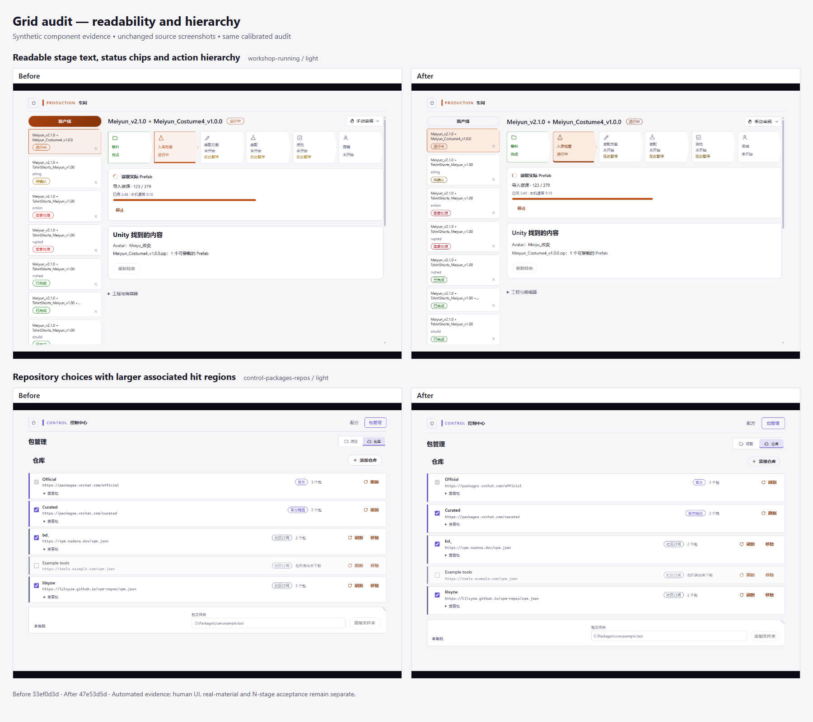
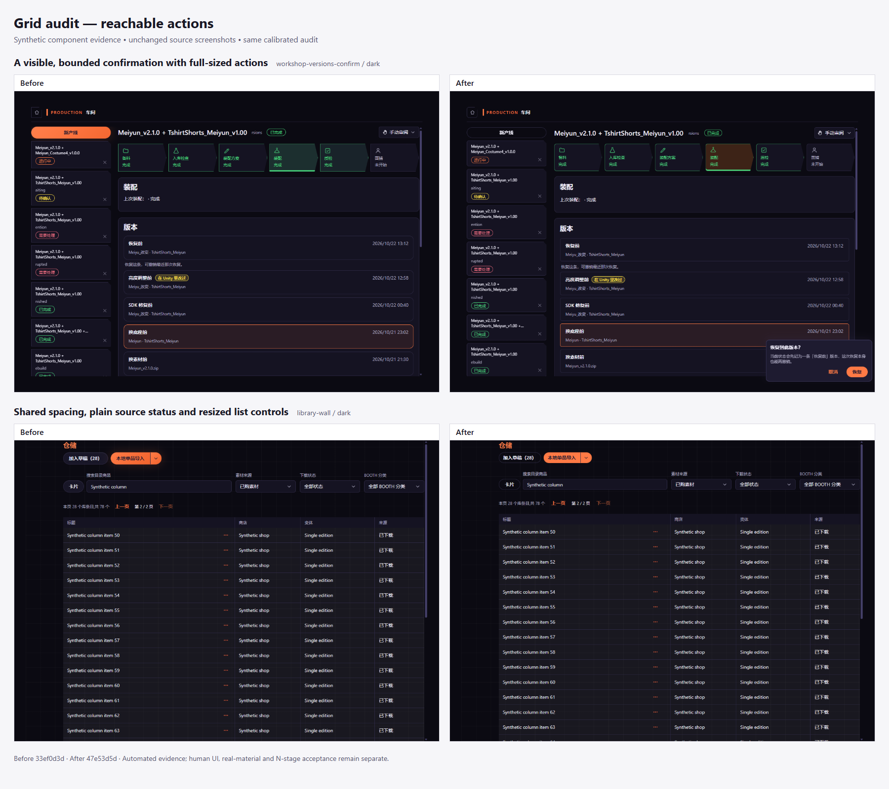

# Design audit calibration and verified Grid repairs

> Updated: 2026-10-25
> Scope: synthetic component evidence for audit reliability and verified interface repairs
> Status: automated comparison complete; author UI review pending

The audit now distinguishes an incomplete collection from design findings, preserves actual
per-state evidence and measures painted controls rather than invisible layout scaffolding.
The [Grid normalization plan](../development/grid-theme-normalization.md) follows the approved
direction in [PR #67](https://github.com/Aran52/VUA/pull/67). This record separates calibration
from corrections to the interface.

## Evidence and comparison method

| Input | Revision | Run |
| --- | --- | --- |
| Historical report requested by the author | historical collection, excluded from the comparison | [40130221511](https://github.com/Aran52/VUA/actions/runs/40130221511) |
| Calibrated auditor, interface before the visual repairs | `33ef0d3d06834601c5367e0da910c99d553a5f11` | [40155851769](https://github.com/Aran52/VUA/actions/runs/40155851769) |
| Same auditor, repaired interface | PR head `47e53d5d27e34c7b7cae35260bd7b317b935d4e0` | [40155868428](https://github.com/Aran52/VUA/actions/runs/40155868428) |

The historical run collected 568 of 594 planned states and omitted 26 fixture execution
failures from its summary. Its per-state groups contained the run plan. It is retained as
diagnostic history and supplies no accepted before/after count.

Both comparison inputs contain byte-identical auditor and fixture sources. The before input
includes the early clicked-product adaptation repair so the current interaction fixture can
execute; that behaviour is verified separately and contributes no claimed visual reduction.
PR-triggered CI checks a synthetic merge revision; the actual collected revision is recorded
in each run's metadata and in the baseline.

Both full runs cover the same 99 views: all rules for Simplified Chinese in dark and light,
then overflow checks for English, Japanese, Korean and Traditional Chinese in dark. Layout
findings count once in the dark state; colour findings count per theme. Counts are affected
element instances, not distinct defects. Worst locale counts/severity are retained by the gate.

| Measure | Calibrated before | Repaired after |
| --- | ---: | ---: |
| Planned / audited states | 594 / 594 | 594 / 594 |
| Execution / capture failures | 0 / 0 | 0 / 0 |
| Missing / duplicate / unexpected states | 0 / 0 / 0 | 0 / 0 / 0 |
| Collected snapshots | 594 | 594 |
| Elements inspected | 72,624 | 72,654 |
| Current-rule instances | 8,523 | 0 |
| Error / warning instances | 152 / 8,371 | 0 / 0 |
| Advisory instances | 8 | 8 |

The repaired run collected merge revision `6c50e9c76c76a3a01ffa3c2c0c7f1f50ebbd48aa`;
its Git tree matches the frozen PR head exactly. Downloaded ZIP digests match GitHub's artifact
metadata. The [before artifact](https://github.com/Aran52/VUA/actions/runs/40155851769/artifacts/12585373318)
and [after artifact](https://github.com/Aran52/VUA/actions/runs/40155868428/artifacts/12584857892)
retain the raw evidence under the workflow's 14-day retention policy.

Raw screenshots, annotated screenshots, computed-style/geometry snapshots, per-state findings
and run summaries remain in the CI artifacts and ignored local evidence. The committed figures
below contain synthetic material only. They come from focused runs at the same frozen revisions,
using the same viewport, fixture actions and evaluator; their source screenshots are unmodified.

## Calibration

| Previous failure | Corrected measurement and retained positive check |
| --- | --- |
| Missing or failed fixture states could disappear from an otherwise large run | Every planned state has exactly one outcome; failed, missing, duplicate, unexpected or empty coverage fails and is visible in both reports |
| Per-state groups contained the run plan | Each state saves its actual findings, geometry and root-cause groups; raw snapshots support later rule inspection |
| Camera paint, hidden labels and stale animations looked like defects | Clip to actual CSS containing blocks and painted visibility; fully clipped/assistive labels and closed details are excluded, while escaping paint and genuinely cropped text still fail |
| Checkbox targets ignored their labels | Include the visible associated label fragment that activates the input; separate fragments never form an invented rectangle |
| Browser leading, unused gaps and auto margins inflated typography/spacing counts | Check actual text and fields, preserve the native-select exception, distinguish measured auto margins and ignore gaps with no layout effect |
| Local colour mixes and focus/selection edges looked like arbitrary paint or elevation | Resolve modern colours and feature-scoped semantic tokens; distinguish inset edges from cast shadows, with real mixed-background contrast and ordinary-panel shadow regressions retained |
| Inactive background actions and status controls looked like competing primary actions | Count active actions per modal scope and split-action group; choices and status indicators retain their roles and hit-area checks |
| Windows hidden-window animation clocks stopped at zero and fixture interactions were unstable | Use offscreen rendering, settle font layout before interactions and verify repeated scripted exits; assertions still fail when a flow cannot complete |
| The task-window fixture opened the default compatibility guide | Select the existing `status` route, execute task/cancellation assertions and verify 1.5× text scaling |
| Annotated screenshots could contain stale paint | Invalidate and retry capture; the pixel assertion still requires the red legend and rejects persistently absent annotations |
| Baselines lost worse locale results or ignored count/severity growth | Format 2 keeps the worst instances/severity per key and rejects new or worsened groups; only a complete full run can refresh the gate |

The library import-dialog title was fully visible in the original screenshot. Its reported
truncation came from applying an unrelated outer clipping region to a fixed descendant.
That item is a corrected false positive, not a claimed UI repair.

## Verified interface repairs

- Multi-selection preserves the clicked product's exact description-link adaptation action.
  Cancelling restores the prior source/search/page, scroll position and complete selection.
- Shared browser defaults and feature spacing follow the 4 px grid; headings and small text
  use the approved type roles. The desktop task window uses those roles at its default size
  and retains the player's scale multiplier.
- Separate semantic text colours keep warning/error/success copy readable on light tinted
  surfaces. Destructive actions use the correct inverse foreground, and selected workshop
  stages use readable accent text. High-contrast mappings remain available.
- Primary actions, ordinary buttons, fields, repository checkbox labels, toggles, list dividers
  and status controls receive usable hit regions. Status indicators stay distinct from action
  emphasis; the workshop and smart package view retain one principal action.
- Confirmation placement measures untransformed dimensions after mounting, clamps both axes
  to the viewport and focuses without scrolling. Actions wrap and remain reachable.
- Ordinary buttons and panels lose decorative gradients, glows and cast shadows. Release
  progress/sign-in, VRChat checks and other nested surfaces use flatter composition; selection
  edges remain. Library corner controls receive a visible inset focus stroke.
- Repeated alert and queued-work border mixes have named semantic component roles.

## Same-rule totals

| Rule | Calibrated before | Repaired after |
| --- | ---: | ---: |
| border-density | 8 | 8 |
| color-token | 141 | 0 |
| contrast | 71 | 0 |
| one-accent | 40 | 0 |
| overflow | 5 | 0 |
| radius-nesting | 58 | 0 |
| shadow-panel | 166 | 0 |
| spacing-grid | 7706 | 0 |
| surface-nesting | 4 | 0 |
| target-size | 76 | 0 |
| type-scale | 177 | 0 |
| type-weight | 79 | 0 |

All 8,523 current-rule instances are resolved under the same calibrated evaluator. No group is
new or worsened against the calibrated before baseline; 1,527 unique baseline groups resolve.
Rules absent from the table have zero instances in both inputs.

The eight remaining `border-density` hints occur in `control-recipes-list`, `library-picker`,
`library-wall`, `workshop-rebuild`, `workshop-switch-adjust`, `workshop-texture`,
`workshop-versions-confirm` and `workshop-versions-plan`. They are advisory comparisons against
the cross-view P90 and retain the same keys/counts in both inputs. They remain visible for the
author's visual review.

## Comparison figures

## Validation

- Both frozen CI inputs passed 51 audit regressions: 44 Node tests and 7 synthetic Electron
  checks. A subsequent reporting-only change labels filtered language/theme plans accurately
  and adds one Node regression; all 52 passed locally. The tests retain real contrast, clipped
  text, small targets, shadows, incomplete coverage, annotation pixels and compositor exits.
- The desktop unit suite passed 1,470 tests; one existing test was skipped. Desktop type,
  semantic contrast, boundary and i18n checks passed.
- Focused runs exercised the changed dialog, library, camera, queued/repository, warning and
  task surfaces across their registered languages/themes. Both the old and repaired task
  typography retain 1.5× scaling; the repaired default typography matches the approved scale.
- The frozen UI head passed schema vectors, TypeScript, Rust, Windows ZIP and NSIS CI checks;
  both complete design-audit jobs passed. Subsequent changes affect report scope labels,
  documentation, comparison assets and the generated baseline; evaluator, fixture interactions
  and UI stay at the measured revision.
- Baseline format 2 was refreshed from the complete after artifact: eight advisory entries,
  no current-rule entries. Rebuilding groups from all 594 saved state files passes the baseline
  check with zero new, increased or severity-worsened groups.

## Remaining acceptance

These are automated synthetic component results. Human approval of the visual sheets,
keyboard/focus experience, real-material flows, physical devices and N-stage acceptance remain
with their owning evidence rows. The audit remains an optional collection check; the required
CI gate policy has not changed.

The wider Grid catalogue migration is still scheduled in the linked plan: shared cut-corner
stroke/focus rendering, complete role/size/state coverage, shell/feature migration and full
motion checks. A zero-current-finding run does not establish those requirements. The registered
views also omit settled Settings categories, tools, wizard steps, some package flows and
separate windows; the audit process lists these coverage gaps. Border-density is advisory.

