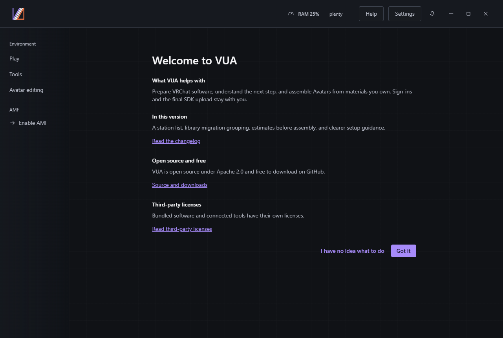
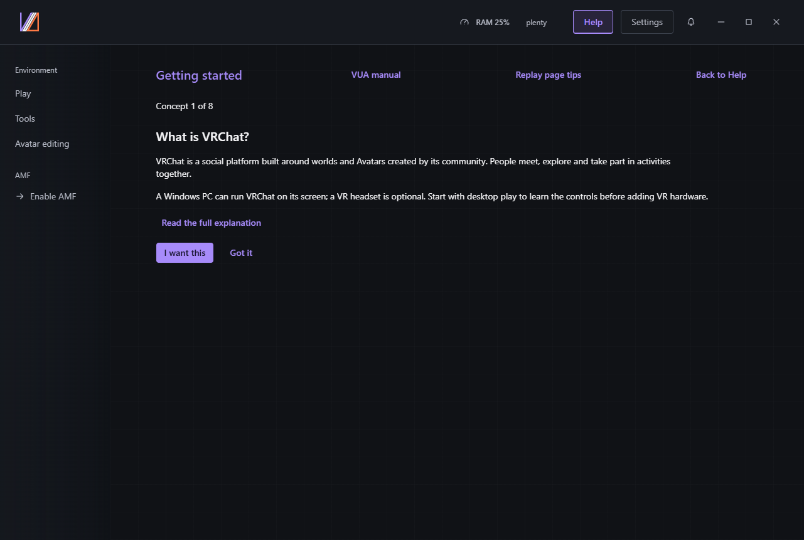
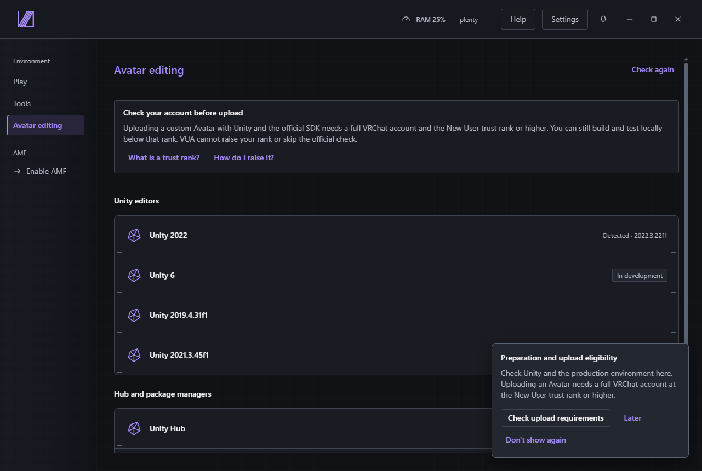
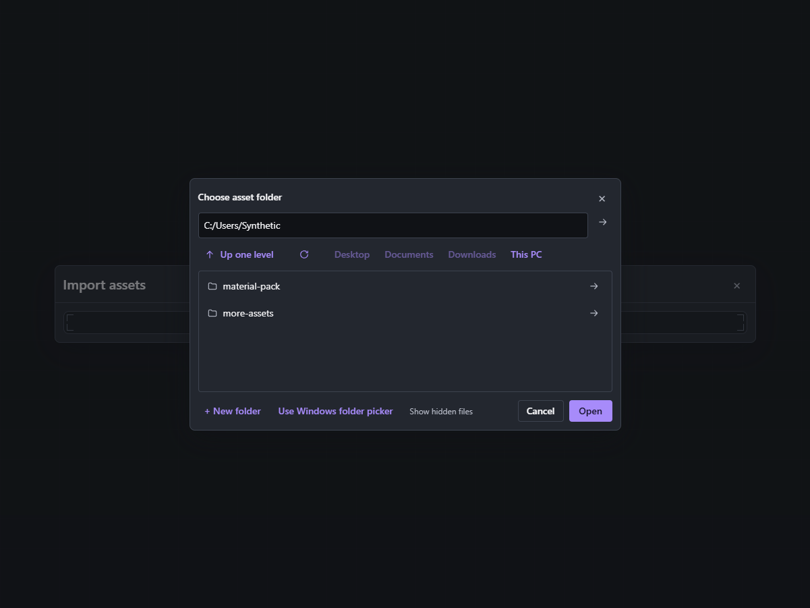
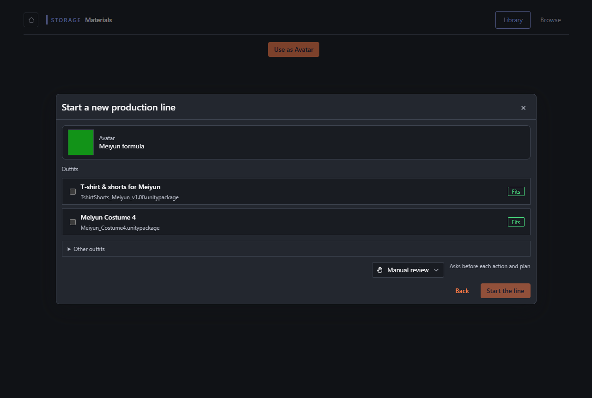
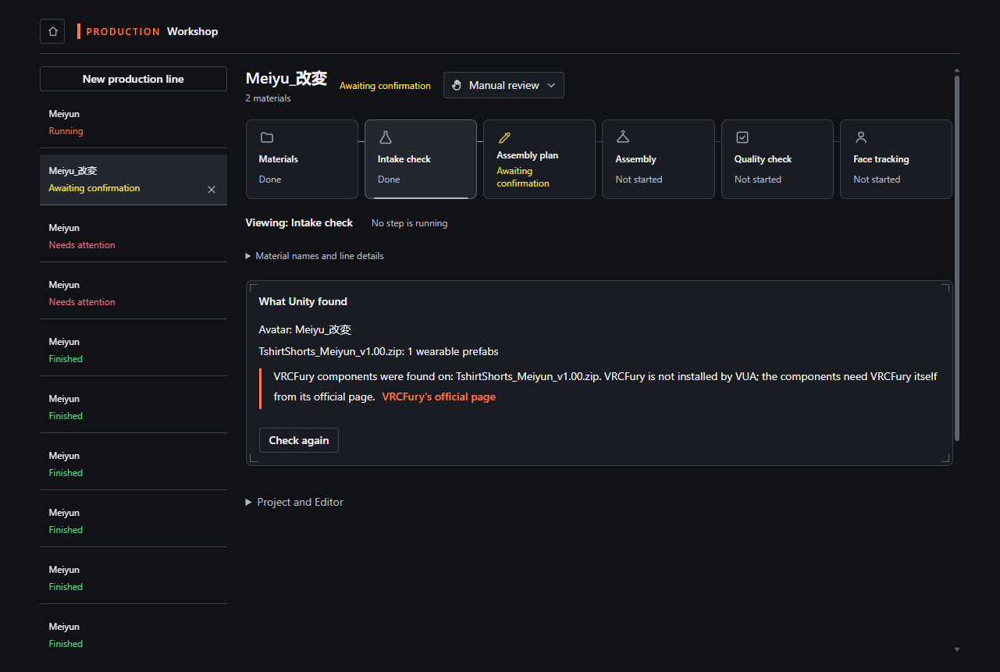
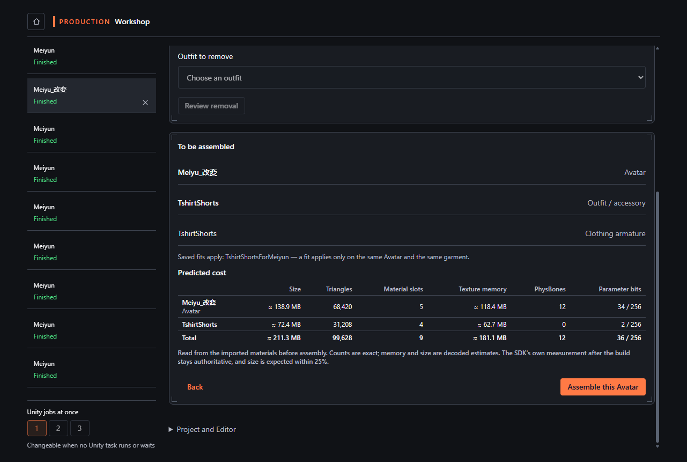
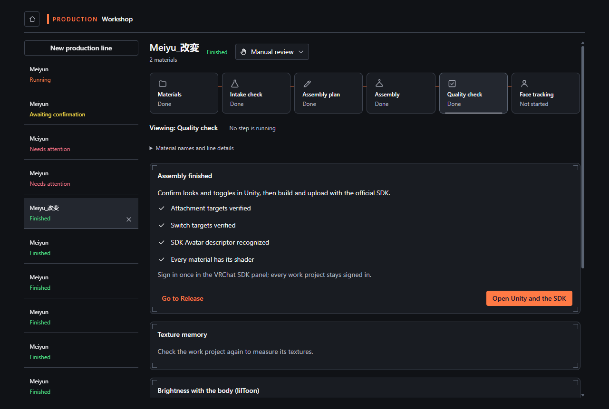
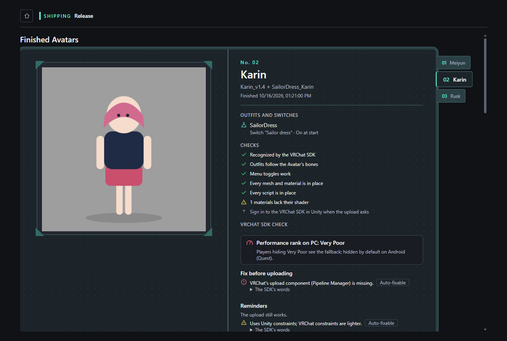

# From Installation to the VRChat SDK

> Version: Virtual Unified Assistant 1.0.0 · AMF 0.3.0 Beta
> Status: candidate guide; awaiting native review and clean-VM walkthrough

[Languages and screenshot source](README.md)

Before starting, prepare a Windows x64 PC, one base avatar package, and one outfit made for that
avatar, all obtained and used under their respective terms of use. The screenshots below show sample
entries and placeholder previews rather than a verified real avatar. While the 1.0.0 installers are
being finalized, follow these steps with the matching published build or the author's designated
test package.

## 1. Install and launch VUA

Use the online setup installer if you have a reliable internet connection, or the offline installer
if you want the runtime bundled upfront. Once installed, launch VUA from the Start menu. External
tools like Unity Hub and SteamVR are still installed from their official websites. If you're
upgrading from 0.7.0, finish any in-progress work and close VUA first (upgrade data-retention
checks are still pending). If installation or startup fails, note the installer version and error
details rather than falling back to an older build. Clean-VM installer screenshots are still
pending author capture.

## 2. Choose how to get started

The first-use notice opens in your system language and walks through VUA's purpose, updates,
downloads/source code, and licensing. Click “Got it” to launch an optional app tour (which you can
skip anytime), or choose the beginner path to step through core concepts one page at a time starting
with “What is VRChat?”. On each card, pick the setup button to set up that tool right away, or move
on to the next topic. You can reopen both the beginner guide and the tour from Help, or switch
languages anytime in Settings.

## 3. Set up your avatar editing environment

Go to **Environment → Avatar editing** and check Unity Hub along with the recommended Unity Editor
version. Follow the Unity license step to sign in or activate a free Personal license in Unity Hub,
then come back and re-check. Turn on the AMF module if it's currently off. If any required software
is missing, follow its official setup link before starting an outfit build.

## 4. Import your original asset files

Open the AMF asset library, choose **Import**, and pick your base avatar and outfit `.unitypackage`
files (or their folders). Review the detected items and confirm the import. If you're bringing over
an entire existing asset folder, use the migration tool to group folders and loose files, resolve
any unassigned, skipped, or unreadable items, and import only the groups you've confirmed. Opening
a preview alone doesn't import anything. If an outfit needs VRCFury or another external tool, follow
its official link and return once installed.

## 5. Start an outfit build

Open your base avatar in the library, choose **Use as Avatar**, pick one compatible outfit, and
click **Start the line**. The Workshop creates a separate working Unity project so your original
`.unitypackage` files stay untouched. Keep the default **Manual review** (*Asks before each action
and plan*) mode selected for this walkthrough. If an item doesn't show up as selectable, make sure
its local files have finished importing first.

## 6. Check the detected prefabs

Once preparation finishes, check the recommended avatar and outfit prefabs and review why VUA
picked them. Fix any missing scripts, shaders, or required packages before moving on. A blocked or
failed check won't pass on its own — follow the suggested action on screen and run the check again.

## 7. Review the plan and build

Check your outfit, bone-attaching, and menu settings alongside the six pre-build estimates:
download/file size, triangle count, material slots, texture memory, PhysBones, and expression
parameter bits. Counts are estimated from source assets, texture memory reflects decoded usage, and
uncompressed size carries a 25% margin — final numbers can shift once the VRChat SDK processes your
avatar. When everything looks right, confirm the plan to start assembly and wait for the build to
finish.

## 8. Inspect the finished build

Review the quality check summary and rotate through the front, side, and back previews. Skipped or
failed checks don't count as passing. If something needs a closer look or a manual tweak, open the
working project in Unity, make your adjustments, and re-run the check. If a build is interrupted,
VUA keeps the run and its restore point so you can continue or retry once the issue is cleared.

## 9. Hand off to the VRChat SDK

Open **Finished Avatars**, select your completed build, and check the SDK readiness notes. Clear
any upload-blocking errors first, and only click the SDK's **Auto Fix** when you understand what it
will change. Open the working project in Unity alongside the VRChat SDK Builder panel to verify how
your avatar looks, animates, and targets PC or Quest. If VRChat login or Trust Rank (`New User`)
blocks uploading, check the linked upload-eligibility guide and come back once unlocked.

This walkthrough wraps up once your project is open and ready for review in the VRChat SDK. Only
upload after verifying the avatar yourself and confirming you hold the rights to use every included
asset. Even when using VUA's guided upload flow, you confirm explicitly and the official VRChat SDK
runs the actual build and upload. Sample screenshots and automated checks can't guarantee how an
avatar will look or behave inside VRChat.
