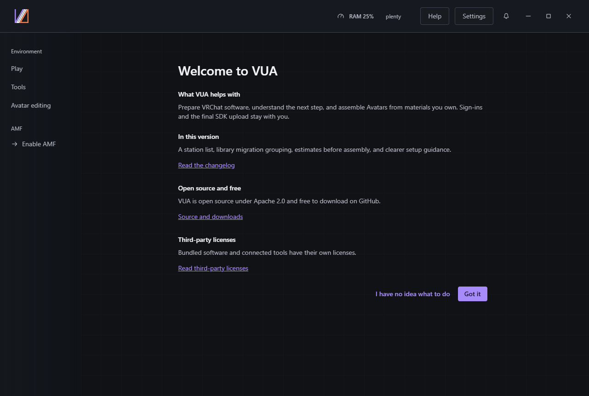
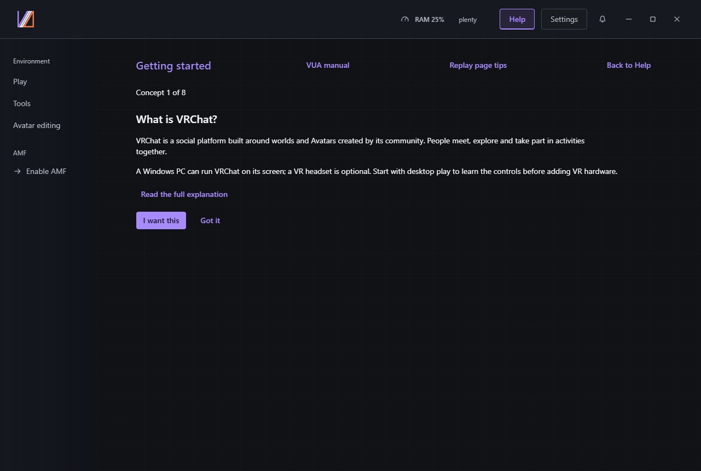
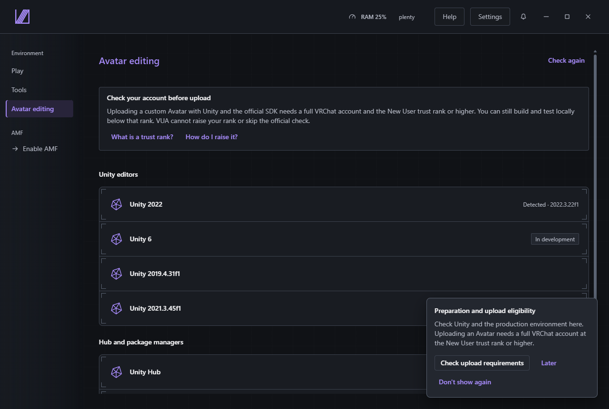
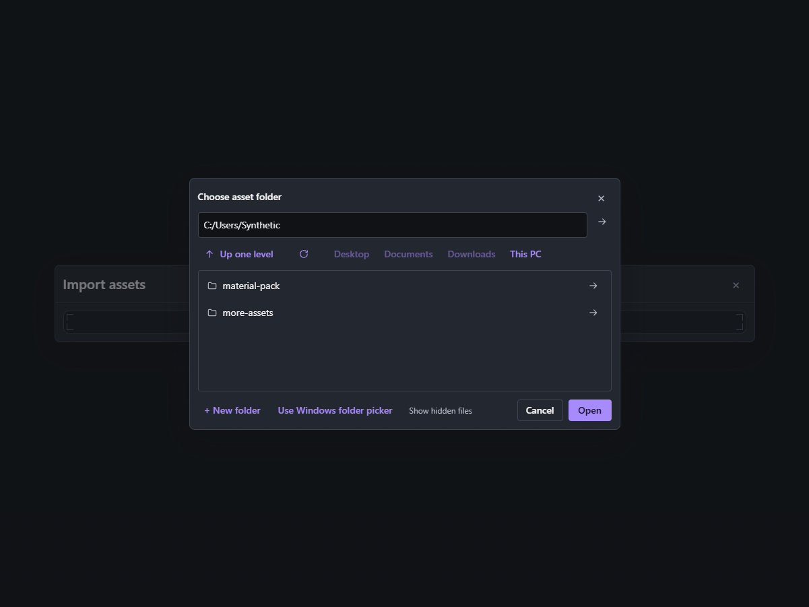
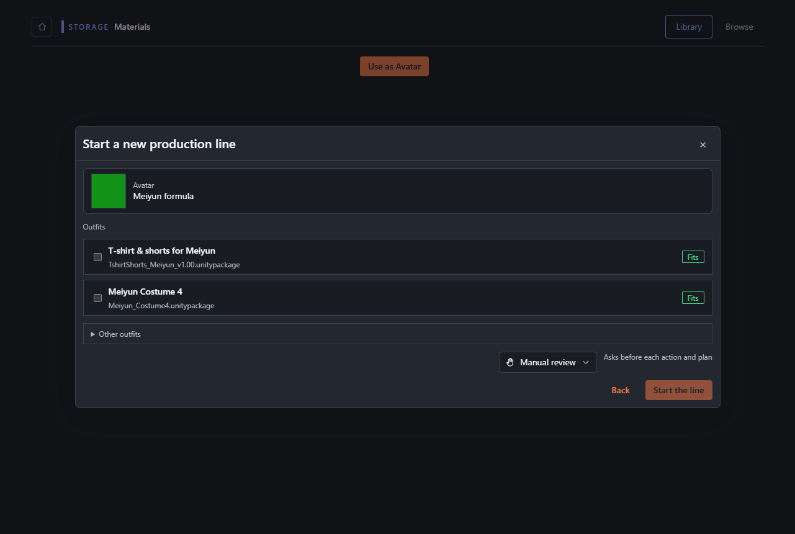
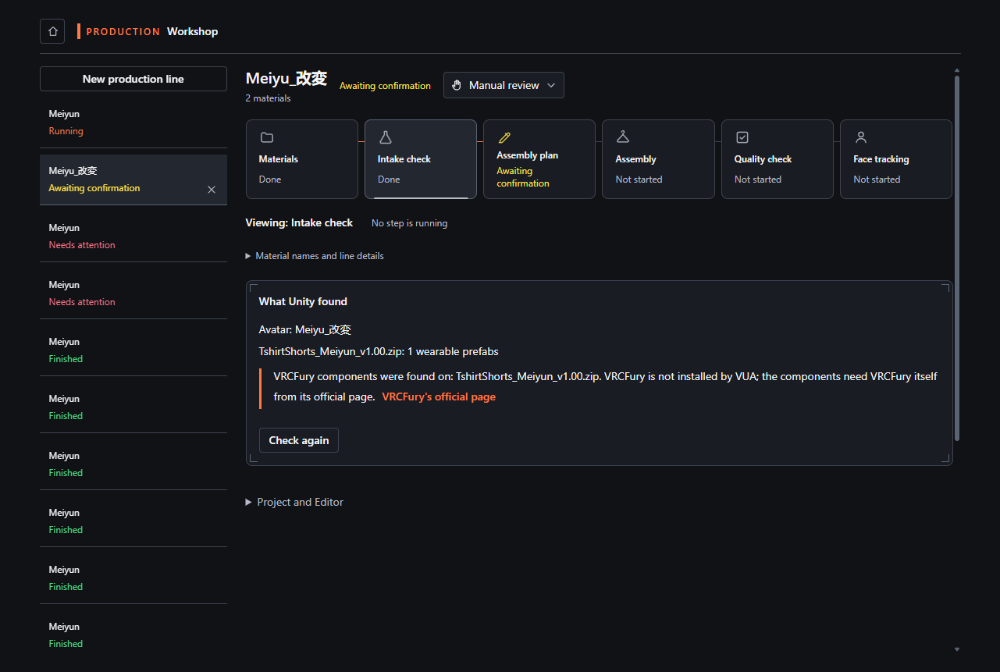
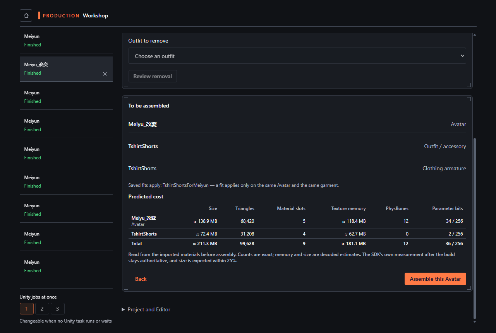
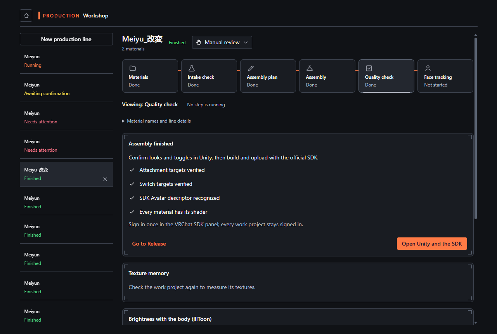
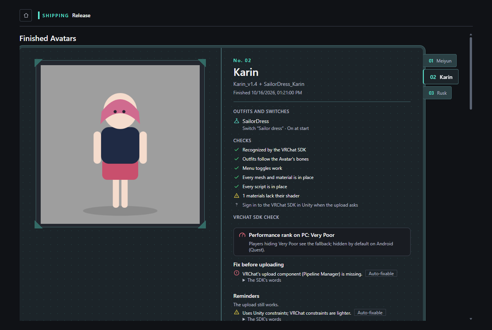

# From installation to the SDK

> Version: Virtual Unified Assistant 1.0.0 · AMF 0.3.0 Beta
> Status: candidate guide; awaiting native review and clean-VM walkthrough

[Languages and screenshot source](README.md)

Use Windows x64, one Avatar package and one outfit made for that Avatar, obtained under their
licenses. Images use sample records and stand-in previews; they do not show a tested real Avatar.
The 1.0.0 installers are still in preparation; use this procedure with the matching published
build or the author's named test package.

## 1. Install and open VUA

Choose the online setup installer when downloads work, or the offline installer when the runtime
must be included. Run it and open VUA from the Start menu. External software still comes from its
official source. For a 0.7.0 upgrade, finish work and exit first; data-retention verification is
still pending. If installation or launch fails, record the installer version and failure instead
of continuing with an older build. Installer images await the author's real clean-VM capture.

## 2. Choose the first-use entry

The notice follows the system language. Read its purpose, changes, source/download and license
sections. “Got it” opens the optional feature tour; it can be skipped. The beginner entry opens
one concept per page, starting with VRChat. Choose the setup action to prepare that thing, or the
next-concept action to continue reading. Help reopens both the guide and tour. Change language in Settings.

## 3. Prepare Avatar editing

Open Environment → Avatar editing. Check Unity Hub and the offered Editor version. Use the
license step's next action to sign in or activate through Unity Hub; check again after returning.
Enable AMF if it is off. If a prerequisite is missing, complete its official handoff before starting a line.

## 4. Import the original materials

Open AMF's materials library and its import menu. Select the Avatar and outfit package files or
their containing folders. Review the detected contents, then confirm import. For a whole old
collection, use migration: assign directories/loose files and resolve unassigned, excluded and
unreadable areas before importing confirmed groups. Opening the preview does not import.
If VRCFury or another guided dependency is required, follow its official link and return.

## 5. Start one line

Open the Avatar's library details and choose “Use as Avatar”. Select one compatible outfit and
“Start the line”. The Workshop opens the line; its separate Unity work project keeps the original
packages intact. Use the default “Ask before changes” mode for this walkthrough. If no usable
material appears, finish importing its local files first.

## 6. Review the detected prefabs

Let preparation finish. At inspection, confirm the Avatar and outfit prefabs and read the reasons
for the recommendations. Resolve missing scripts, shaders or dependencies before continuing.
A blocked or failed step stays unpassed; use its shown action, then inspect again.

## 7. Review the plan and assemble

Check the outfit, binding/menu choices and all six predictions: size, triangles, material slots,
texture memory, PhysBones and parameter bits. Counts describe source estimates, texture memory
uses the decoded estimate and uncompressed size has a stated 25% tolerance; SDK-generated or
changed content can differ. Review the plan and approve assembly. Wait for the actual result.

## 8. Check the result

Read the completed line's quality results and inspect the front, side and back previews. A missing
or failed check is not a pass. Open the work project in Unity when a fix or visual check is needed;
then run inspection again. Keep the line and its restore point when interrupted, and use the
displayed continue/retry action after the blocker is resolved.

## 9. Hand the project to the SDK

Open Finished Avatars, select this line and read the SDK findings. Fix blocking errors; use the
SDK's Auto Fix only when offered and understood. Open the corresponding project in Unity and
the VRChat SDK panel to inspect appearance, behavior and the target platform. If sign-in or trust
rank blocks upload, use the linked upload-eligibility explanation and return after resolving it.

The walkthrough is complete when this project reaches the SDK for review. Upload only after
checking the result and confirming content rights. VUA's managed upload requires explicit
confirmation; the official SDK performs the build/upload. Record its actual result. A sample
screenshot or technical check cannot guarantee how an Avatar looks or behaves in VRChat.
