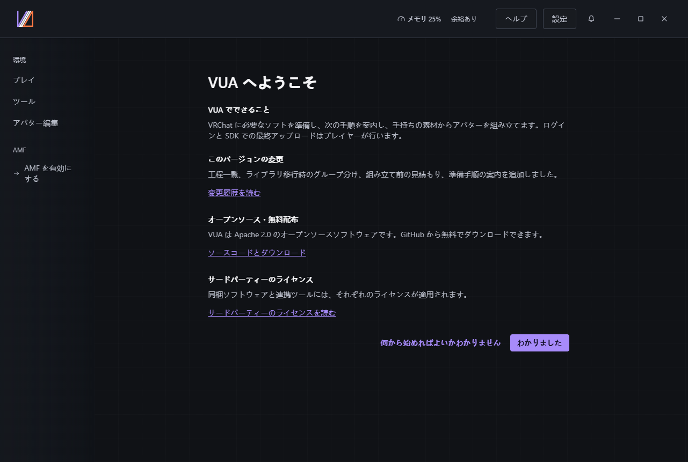
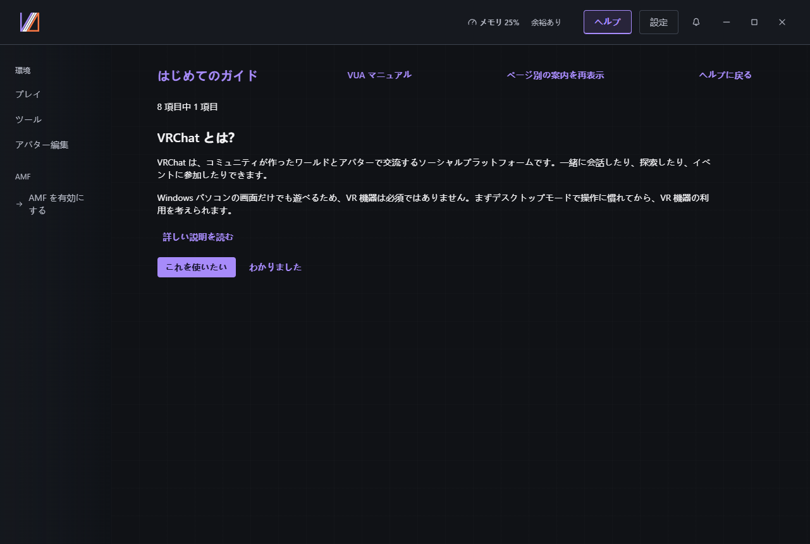
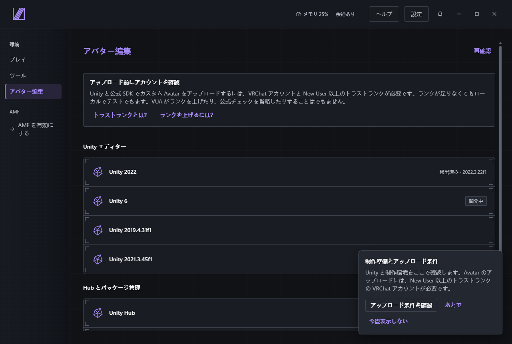
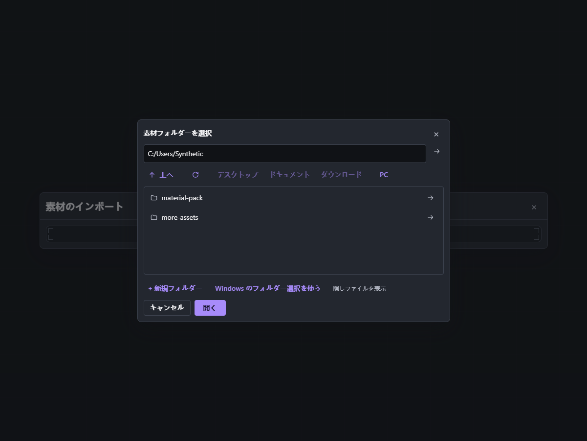
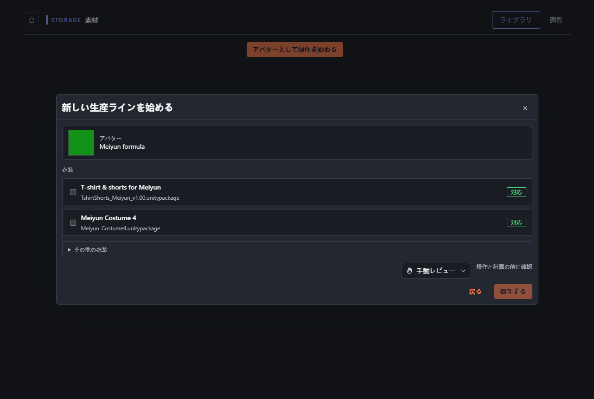
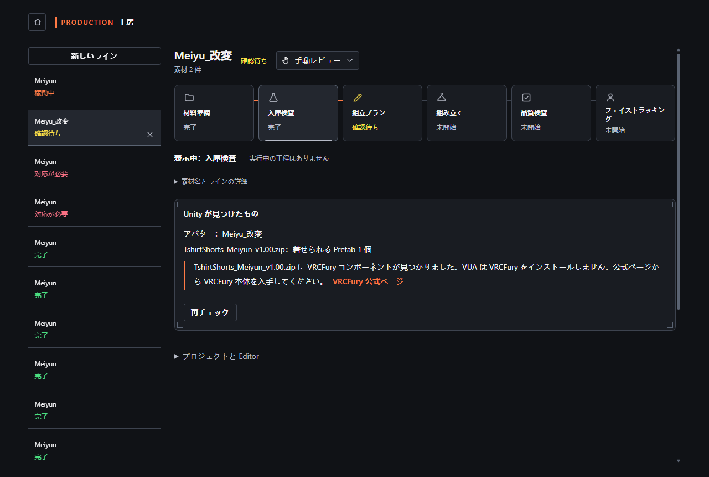
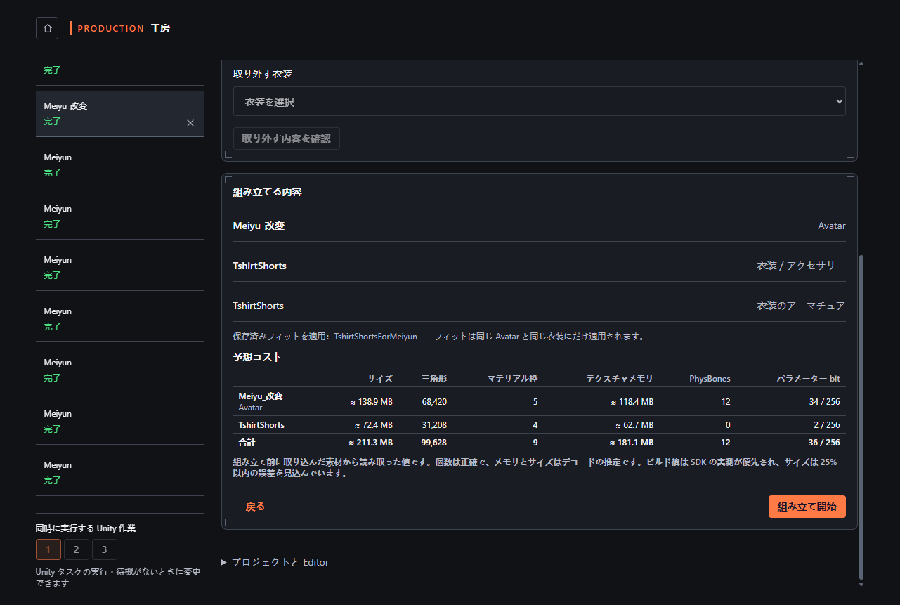
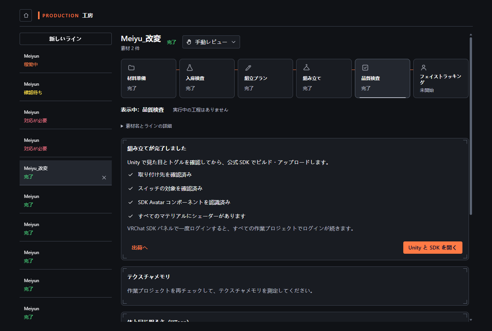
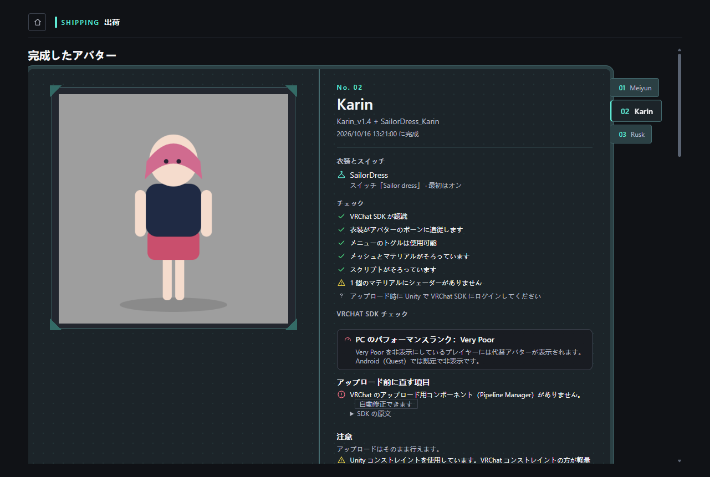

# インストールから SDK まで

> バージョン：Virtual Unified Assistant 1.0.0 · AMF 0.3.0 Beta
> 状態：候補ガイド。awaiting native review（母語話者の確認待ち）、クリーン VM での手順確認待ち

[言語と画像の出典](README.md)

Windows x64、Avatar の元パッケージ、その Avatar 向け衣装一着を用意し、それぞれの利用条件に従ってください。
画像はサンプル記録と代用プレビューです。実際の Avatar の検証結果ではありません。
1.0.0 インストーラーは準備中です。対応する公開版、または作者が指定するテストパッケージで実行してください。

## 1. インストールして開く

通信が安定している場合はオンライン版、ランタイムを含める場合はオフライン版を実行します。
開始メニューから VUA を開きます。外部ソフトは各公式配布元から取得します。
0.7.0 から更新する場合は制作を終えて終了してください。データ保持は確認待ちです。
導入・起動に失敗した場合は版と状況を記録し、旧版で続けて完了扱いにしないでください。
インストーラー画像は作者の実際のクリーン VM での取得待ちです。

## 2. 初回の入口を選ぶ

初回説明はシステムの言語に従い、用途、変更、ソースとダウンロード、ライセンスを表示します。
確認するとスキップ可能な機能ツアーへ進みます。初心者向け入口では「VRChat とは」から一ページに一概念を説明します。
使いたい項目の準備画面へ進むか、次の概念を読みます。ヘルプから再開でき、設定で言語を変えられます。

## 3. Avatar 編集を準備する

環境の Avatar 編集ページを開き、Unity Hub と表示された Editor の版を確認します。
ライセンス手順の次の操作に従って Unity Hub でログイン・有効化し、戻って再確認します。
AMF が無効なら有効にしてください。前提ソフトが不足する場合は公式の手順を終えてから制作へ進みます。

## 4. 元の素材を取り込む

AMF 素材ライブラリのインポートメニューから Avatar と衣装のパッケージ、またはフォルダーを選びます。
検出内容を確認して取り込みます。古いライブラリ全体の移行ではフォルダーと個別ファイルを整理し、
未割当・除外・読取不可を確認してから確認済みグループだけを取り込みます。プレビューを開くだけでは取り込みません。
VRCFury などの案内が出た場合は公式リンクの手順を終えて戻ります。

## 5. 一つのラインを始める

Avatar の素材詳細から Avatar として使う操作を選び、対応する衣装一着を選択してラインを開始します。
ワークショップが開き、元パッケージを保ったまま別の Unity 作業プロジェクトを用意します。
今回は既定の変更前に確認するモードを使います。素材が出ない場合は元ファイルの取り込みを先に完了します。

## 6. 検出した Prefab を確認する

準備が終わったら検査工位で Avatar と衣装の Prefab、推薦理由を確認します。
欠落したスクリプト、シェーダー、依存パッケージを解決してから進みます。
未実行・失敗を合格にはしません。表示された操作で解決して再検査します。

## 7. 計画を確認して組み立てる

衣装、バインド、メニューと、サイズ、三角形数、マテリアルスロット、テクスチャメモリ、PhysBones、
パラメータビットの六項目を確認します。数は元データに基づき、テクスチャはデコード時の推定、
非圧縮サイズには 25% の許容差が示されます。SDK が生成・変更した内容は異なる場合があります。
計画を確認して組み立てを承認し、実際の結果を待ちます。

## 8. 結果を検査する

完成ラインの品質結果と正面・側面・背面を確認します。未実行や失敗は合格ではありません。
修正や目視確認が必要なら Unity で作業プロジェクトを開き、対応後に再検査します。
中断時はラインと復元点を保持し、原因を解決してから表示された続行・再試行を選びます。

## 9. SDK へ渡す

完成 Avatar の画面で対象ラインと SDK の指摘を確認します。阻止エラーを先に直し、
SDK の自動修正は表示され、内容を理解できる場合に使います。
Unity で対応するプロジェクトと VRChat SDK パネルを開き、見た目、動作、対象プラットフォームを確認します。
ログイン・信頼ランクが障害なら、リンクされたアップロード資格の説明に従って戻ります。

このプロジェクトを SDK で確認できれば手順は完了です。結果と利用権を確認してからアップロードします。
VUA の管理アップロードも明示確認が必要で、ビルドと送信は公式 SDK が実行します。実際の結果を記録してください。
サンプル画像や技術検査は VRChat 内の見た目・動作を保証しません。
