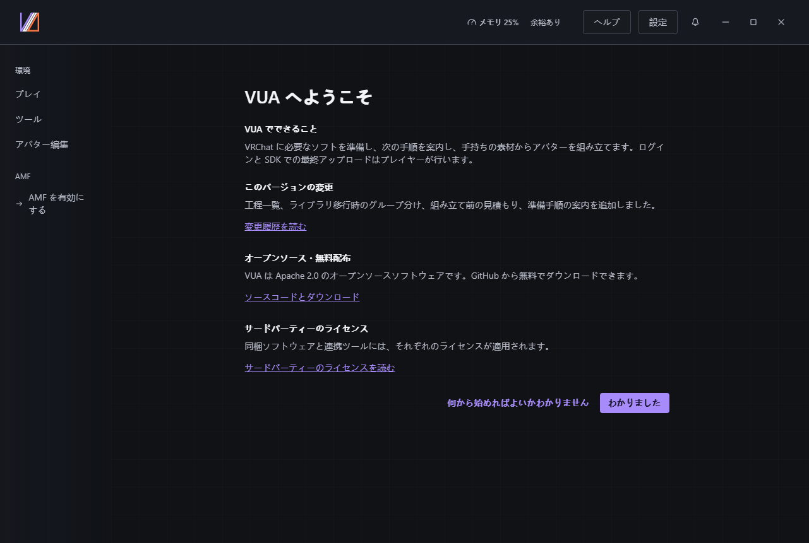
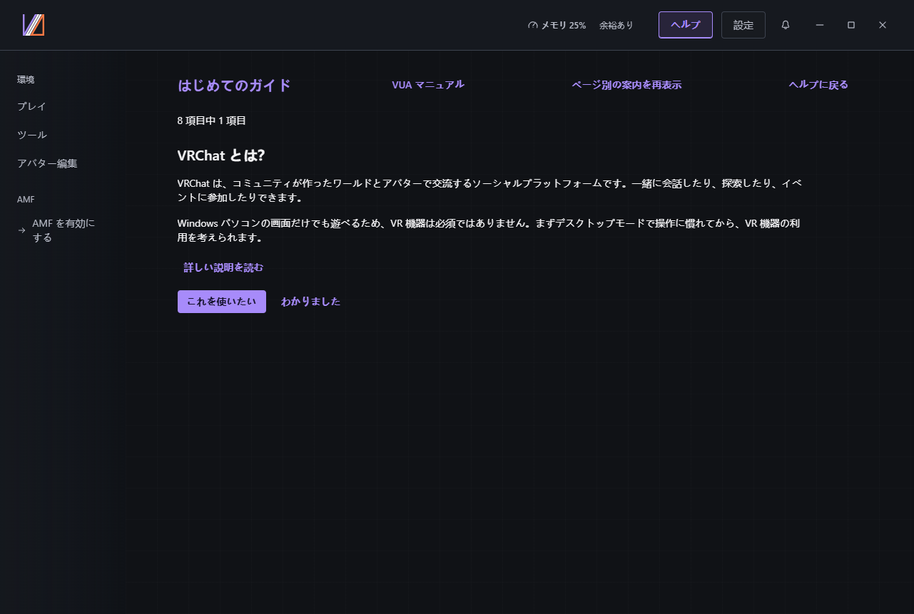
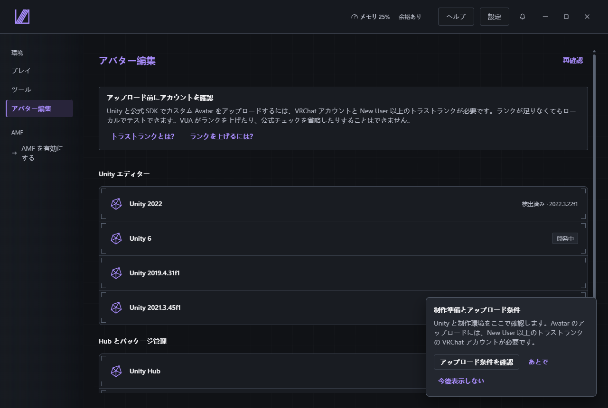
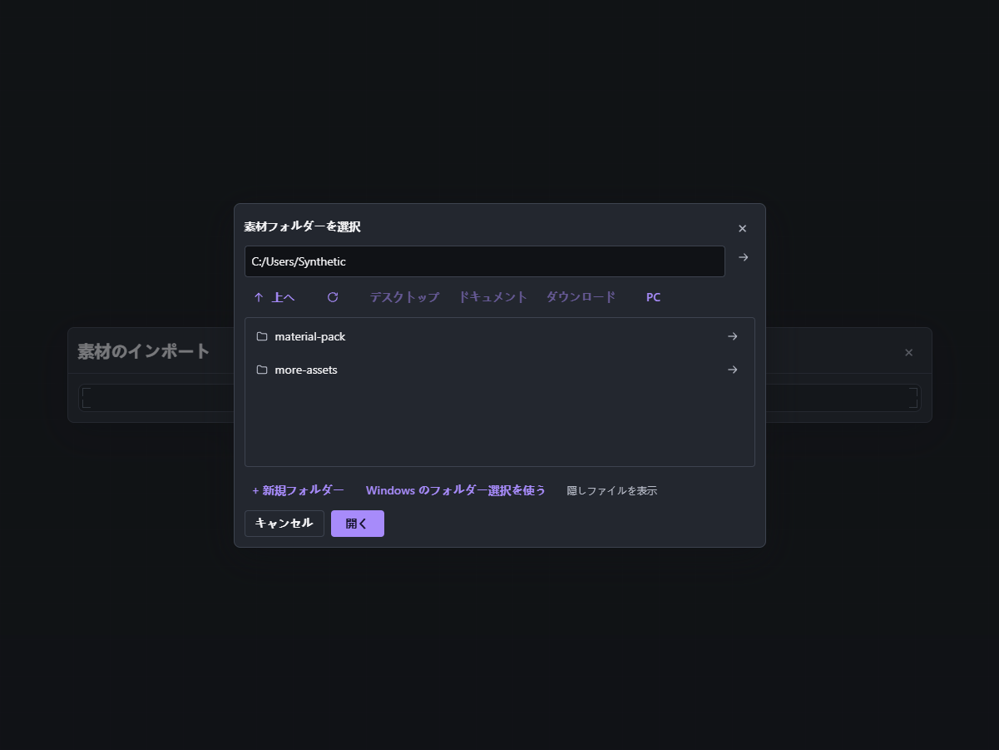
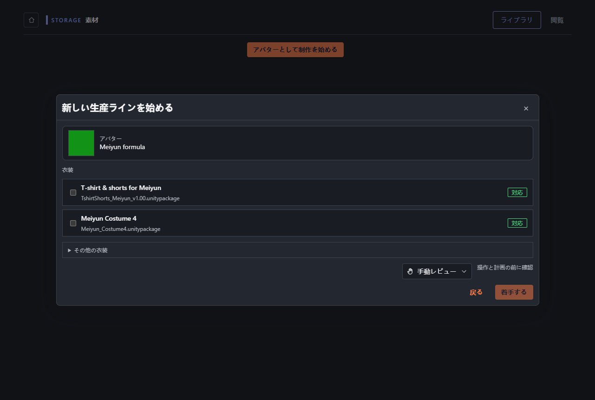
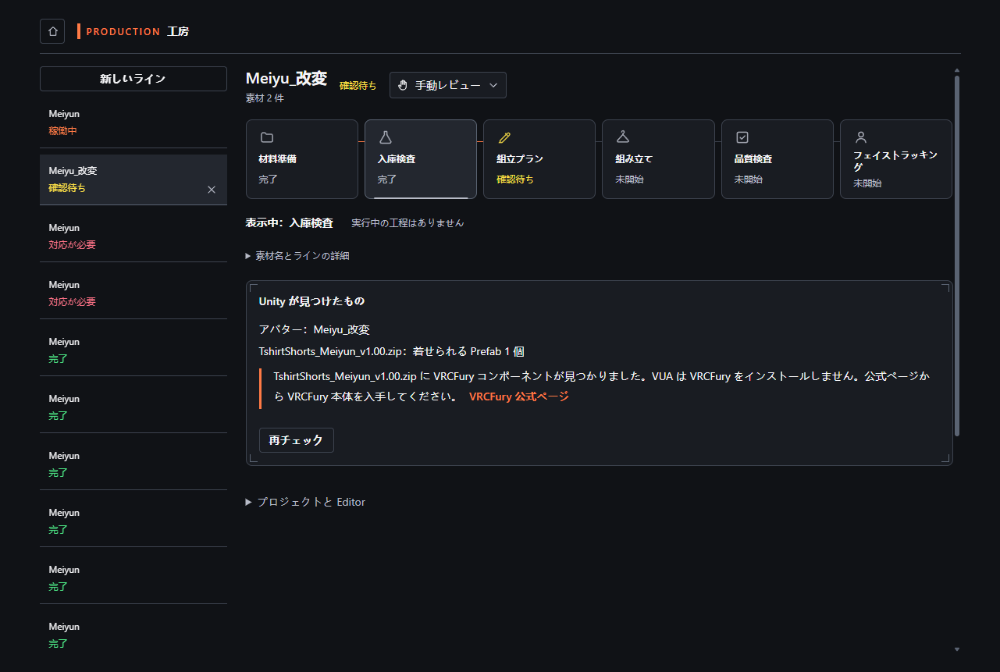
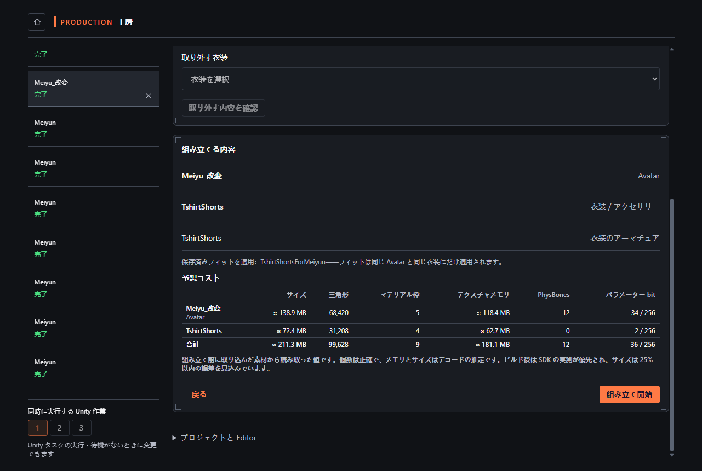
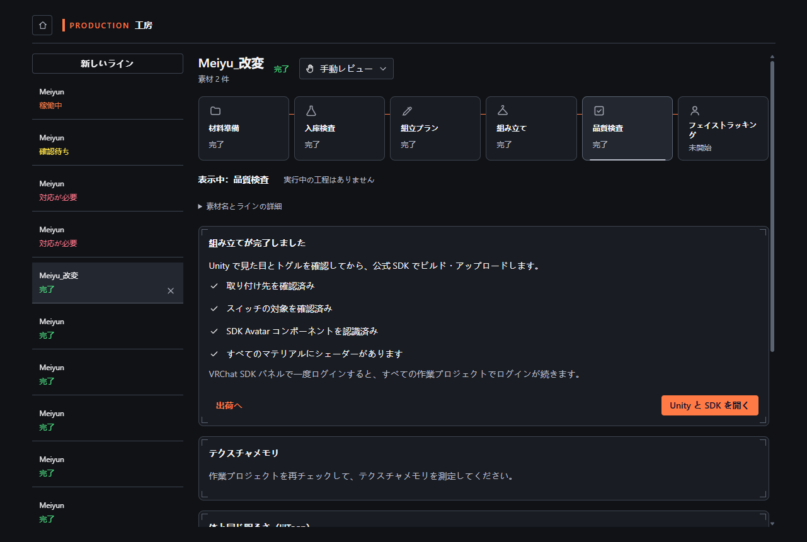
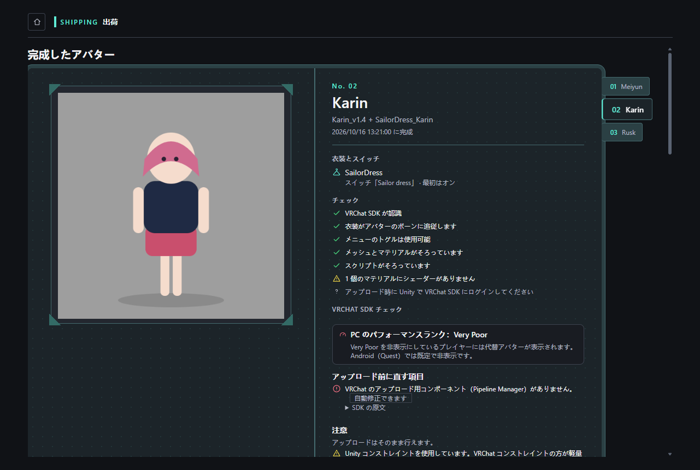

# インストールから VRChat SDK 引き継ぎまで

> バージョン：Virtual Unified Assistant 1.0.0 · AMF 0.3.0 Beta
> 状態：候補ガイド。awaiting native review（母語話者の確認待ち）、クリーン VM での通し確認待ち

[言語とスクリーンショットの出典](README.md)

始める前に、Windows x64 環境の PC と、それぞれの利用規約に従って入手したベースアバター（素体）のパッケージ 1 つ、およびそのアバターに対応した衣装 1 着を用意してください。
掲載している画面写真はサンプルデータと仮プレビューによるもので、実際のアバターの動作検証を示すものではありません。1.0.0 インストーラーは現在準備中のため、対応する公開ビルドまたは作者指定のテストパッケージで手順を進めてください。

## 1. VUA をインストールして起動する

ネット接続が安定している場合はオンライン版インストーラー、実行環境ごとまとめて導入したい場合はオフライン版インストーラーを実行します。インストールが終わったら、Windows のスタートメニューから VUA を起動します。
Unity Hub や SteamVR などの外部ソフトは、それぞれの公式サイトから入手します。0.7.0 からアップデートする場合は、作業中の内容を終えて VUA を終了してから実行してください（更新時のデータ引き継ぎ検証は現在確認待ちです）。
インストールや起動に失敗した場合はバージョンとエラー内容を記録し、古いバージョンのまま手順を続けないでください。インストーラー画面のキャプチャは、クリーン VM 上での撮影待ちです。

## 2. 初回起動時の案内を確認する

初回起動時の案内は OS の表示言語に合わせて開き、VUA の目的・アップデート方法・ソースコードと配布元・ライセンスを確認できます。
「わかりました」を押すと機能ツアー（スキップ可能）に進みます。基礎から順番に知りたい場合は初心者向けガイドを選ぶと、「VRChat とは？」から 1 ページずつ仕組みを確認でき、その場で準備画面へ進むか次の解説へ進むかを選べます。
初心者ガイドと機能ツアーは「ヘルプ」からいつでも開き直せます。表示言語は「設定」から変更できます。

## 3. アバター改変の環境を整える

「環境 → アバター改変」を開き、Unity Hub と案内されている推奨バージョンの Unity エディターが入っているか確認します。
ライセンス確認の手順に沿って Unity Hub でサインインし、ライセンスを有効化してから VUA に戻って再確認してください。
AMF モジュールがオフになっている場合はオンに切り替えます。不足している前提ソフトがある場合は、公式案内に沿って導入を済ませてからセットアップに進みます。

## 4. アバターと衣装の素材を取り込む

AMF 素材ライブラリの取り込みメニューから、ベースアバターと対応衣装の `.unitypackage` ファイル（または入っているフォルダー）を選択し、検出内容を確認して取り込みます。
手元の既存素材フォルダーをまとめて整理する場合は移行ツールを使い、フォルダーや個別ファイルの振り分けと、未割り当て・除外・読み取り不可の項目を確認したうえで、確定したグループだけを取り込みます（プレビューを開いただけでは取り込まれません）。
VRCFury などの前提ツールが案内された場合は、公式リンク先の手順を終えてから戻ってください。

## 5. 着せ替えのセットアップを始める

ライブラリでベースアバターの詳細を開き、「素体として使う」を選んで対応衣装を 1 着チェックし、セットアップを開始します。
工房では元の `.unitypackage` ファイルを書き換えずに、専用の Unity 作業プロジェクトを新しく用意します。この手順では既定の「変更前に確認する」モードのまま進めてください。
選びたい素材が表示されない場合は、先にローカルファイルの取り込みが完了しているか確認してください。

## 6. 検出された Prefab を確認する

準備が終わったら、チェック画面でベースアバターと衣装の Prefab および推奨理由を確認します。
不足しているスクリプト・シェーダー・前提パッケージがある場合は、画面の案内に従って解消してから次に進みます。中断やエラーが出ている項目はそのままでは通過できないため、対処後に再チェックしてください。

## 7. セットアップ計画と予測値を確認して組み立てる

衣装の着せ方やメニュー設定とあわせて、容量・ポリゴン数（三角面）・マテリアルスロット・テクスチャメモリ・PhysBones・パラメータービット数の 6 項目の予測値を確認します。
各数値は元素材からの推定値で、テクスチャメモリは展開時サイズの見積もり、非圧縮サイズには 25% の許容幅があります（VRChat SDK や非破壊ツールがビルド時に生成・変更する分とは差が出ることがあります）。
内容を確認したら計画を確定してセットアップを実行し、完了まで待ちます。

## 8. 仕上がりとチェック結果を確認する

セットアップ完了後の品質チェック結果と、正面・側面・背面のプレビューを確認します。未実行やエラーの項目は合格扱いになりません。
手直しや Unity 上での見た目確認が必要な場合は作業プロジェクトを Unity で開き、調整後に再チェックを実行してください。
途中で中断した場合も作業ラインと復元ポイントが残るため、原因を解消してから画面の「続行」または「再試行」で再開できます。

## 9. VRChat SDK へ引き継ぐ

「完成アバター」画面で今回のビルドを選び、SDK 側のチェック内容を確認します。アップロードを妨げるエラーがあれば先に解消し、SDK の自動修正（Auto Fix）は表示内容を理解できる場合にのみ実行してください。
続いて Unity で作業プロジェクトと VRChat SDK パネルを開き、見た目・表情やメニューの動作・対象プラットフォーム（PC / Quest）を確認します。
VRChat へのログインやトラストランク（`New User` 以上）の条件でアップロードできない場合は、画面内の案内リンクを確認して条件を満たしてから戻ってください。

このプロジェクトを VRChat SDK パネル上で確認できる状態になれば、本ガイドの手順は完了です。アップロードは、仕上がりをご自身で確認し、使用している全素材の利用規約を満たしていることを確かめてから行ってください。
VUA のアップロード補助を使う場合も必ず明示的な確認が必要となり、実際のビルドとアップロード処理は公式の VRChat SDK が行います。サンプル画面や自動チェックは、VRChat 内での実際の見た目や動作を保証するものではありません。
