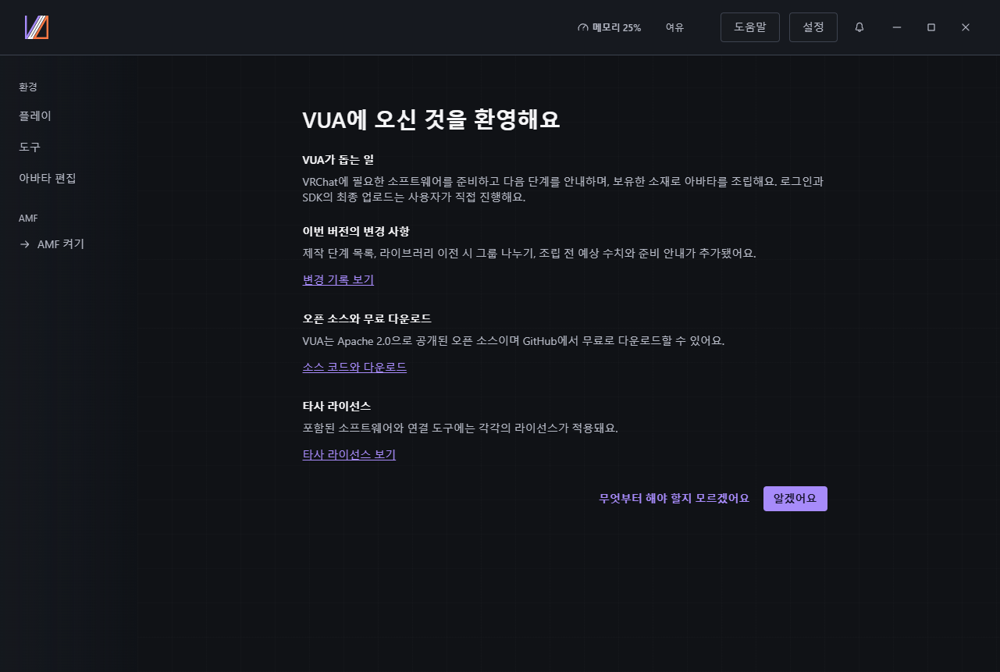
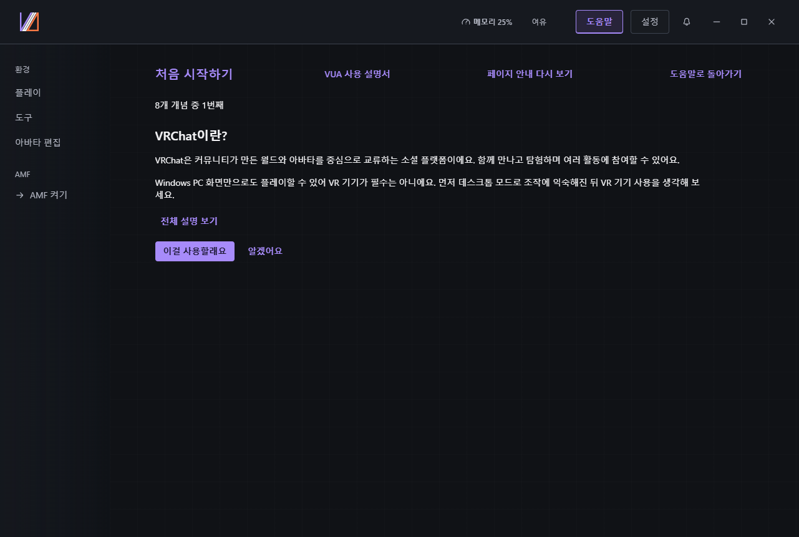
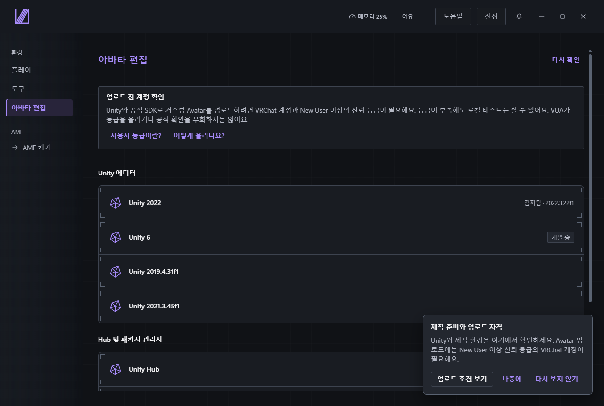
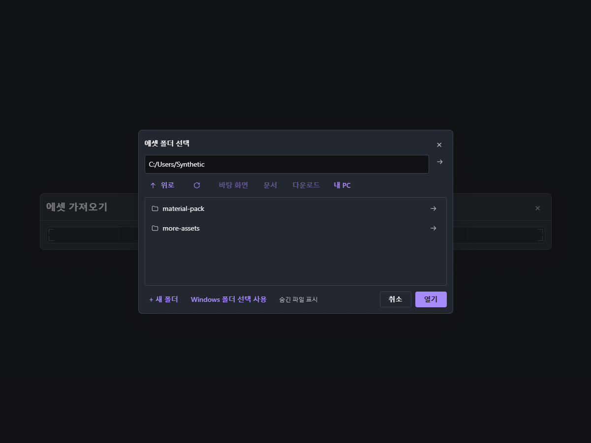
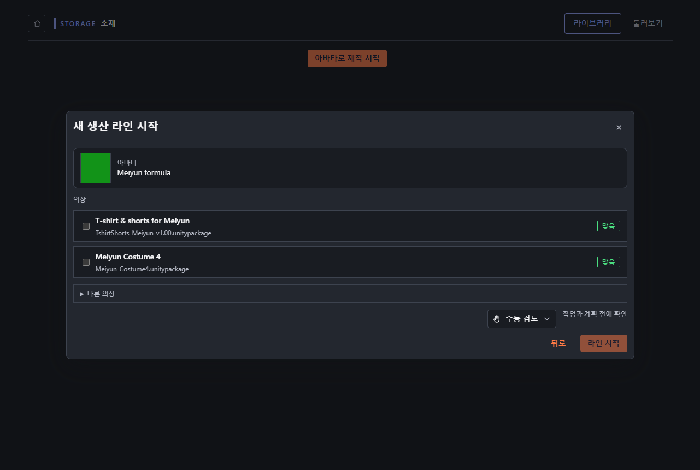
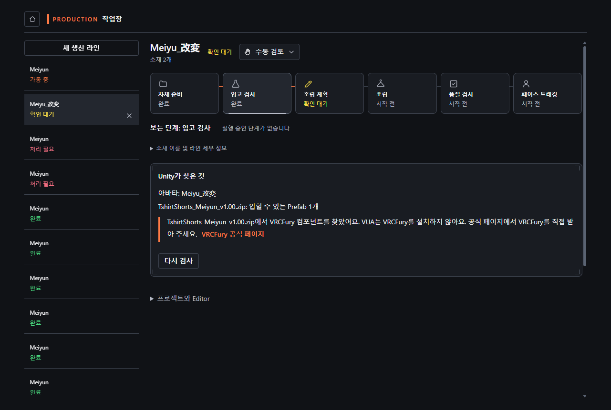
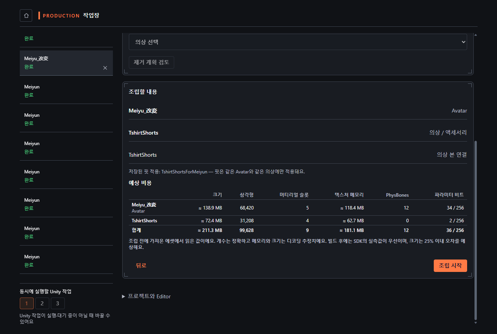
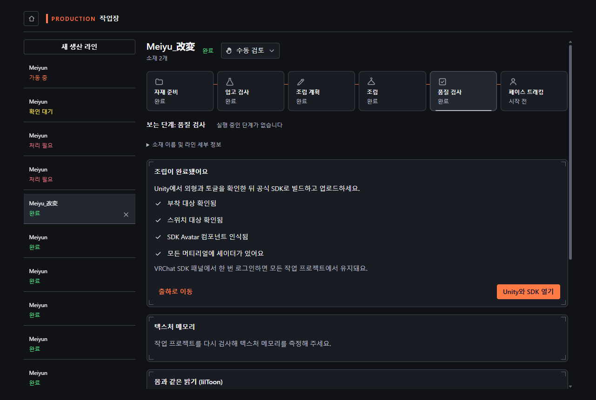
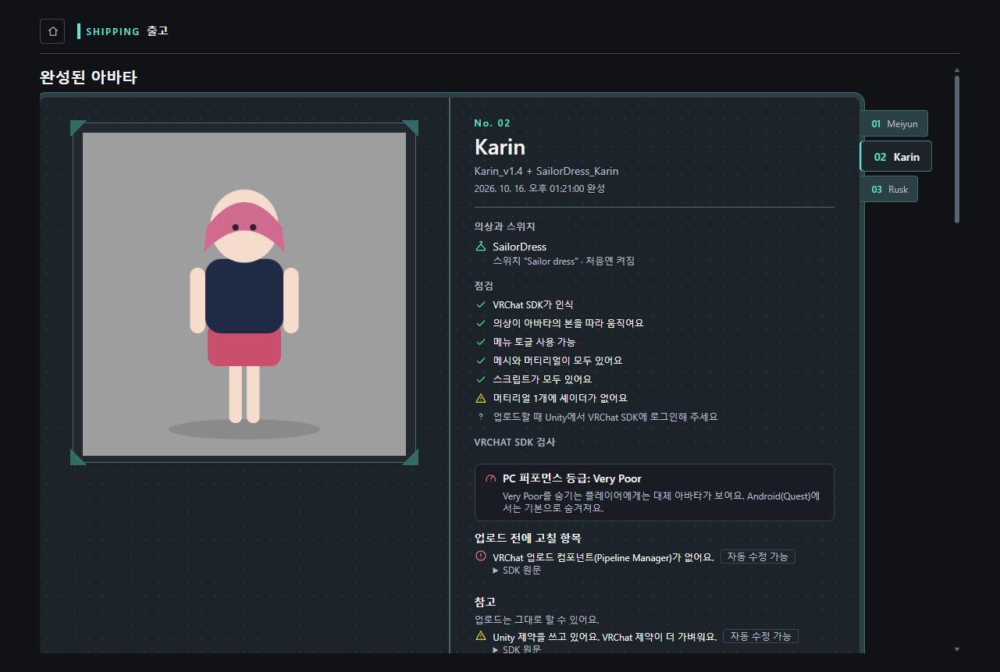

# 설치부터 SDK까지

> 버전: Virtual Unified Assistant 1.0.0 · AMF 0.3.0 Beta
> 상태: 후보 안내서. awaiting native review(원어민 검토 대기), 깨끗한 VM에서 절차 검수 대기

[언어와 캡처 출처](README.md)

Windows x64와 Avatar 원본 패키지, 그 Avatar에 맞는 의상 한 벌을 준비하고 각각의 이용 조건을 따라 주세요.
이미지는 예시 기록과 대체 미리보기를 사용합니다. 실제 Avatar 검수 결과가 아닙니다.
1.0.0 설치 파일은 준비 중입니다. 해당 공개 빌드 또는 작성자가 지정한 테스트 패키지로 진행하세요.

## 1. 설치하고 열기

다운로드가 원활하면 온라인 설치 파일, 런타임이 포함되어야 하면 오프라인 설치 파일을 실행합니다.
시작 메뉴에서 VUA를 엽니다. 외부 소프트웨어는 각 공식 배포처에서 받습니다.
0.7.0에서 올리기 전에는 제작을 마치고 종료하세요. 데이터 보존은 아직 확인 대기입니다.
설치·실행이 실패하면 버전과 상황을 기록하고, 이전 버전으로 계속해서 완료 처리하지 마세요.
설치 화면 이미지는 작성자의 실제 깨끗한 VM에서 캡처해야 합니다.

## 2. 첫 사용 항목 선택

첫 안내는 시스템 언어로 목적, 변경 사항, 소스·다운로드, 라이선스를 보여 줍니다.
확인하면 건너뛸 수 있는 기능 둘러보기가 시작됩니다. 입문 항목은 ‘VRChat이란?’부터 한 페이지에 개념 하나를 설명합니다.
필요한 항목을 준비하는 화면으로 이동하거나 다음 개념을 읽습니다.
도움말에서 다시 열 수 있고 설정에서 언어를 바꿀 수 있어요.

## 3. Avatar 편집 준비

환경의 Avatar 편집 화면에서 Unity Hub와 제시된 Editor 버전을 확인합니다.
라이선스 단계의 다음 동작에 따라 Unity Hub에서 로그인·활성화한 뒤 돌아와 다시 확인합니다.
AMF가 꺼져 있으면 켜세요. 필요한 프로그램이 없으면 공식 절차를 마친 뒤 제작을 시작합니다.

## 4. 원본 소재 가져오기

AMF 소재 라이브러리의 가져오기 메뉴에서 Avatar·의상 패키지나 폴더를 선택하고 감지된 내용을 확인해 가져옵니다.
기존 라이브러리 전체를 옮길 때는 폴더와 낱개 파일을 분류하고 미할당·제외·읽기 불가 구역을 확인한 뒤,
확인된 묶음만 가져옵니다. 미리보기를 열기만 해서는 가져오지 않습니다.
VRCFury 같은 의존 패키지 안내가 나오면 공식 링크의 절차를 마친 뒤 돌아옵니다.

## 5. 제작 라인 하나 시작

Avatar 소재 상세에서 Avatar로 사용하는 동작을 선택하고 호환되는 의상 한 벌을 고른 뒤 라인을 시작합니다.
작업장이 열리고 원본 패키지를 보존한 별도 Unity 작업 프로젝트가 준비됩니다.
이번에는 기본인 변경 전 확인 모드를 사용합니다. 소재가 보이지 않으면 원본 로컬 파일을 먼저 가져오세요.

## 6. 감지 결과 확인

준비가 끝나면 검사 작업대에서 Avatar·의상 Prefab과 추천 이유를 확인합니다.
누락된 스크립트, 셰이더, 의존 패키지를 해결한 뒤 진행합니다.
막히거나 실패한 단계는 통과한 것이 아닙니다. 표시된 동작으로 해결하고 다시 검사합니다.

## 7. 계획 확인 후 조립

의상, 바인딩, 메뉴와 크기·삼각형 수·머티리얼 슬롯·텍스처 메모리·PhysBones·파라미터 비트 예측을 확인합니다.
개수는 원본 내용 기준이며, 텍스처 메모리는 디코딩 추정치, 비압축 크기에는 25% 허용 오차가 표시됩니다.
SDK가 생성하거나 바꾼 내용은 달라질 수 있어요. 계획을 검토해 조립을 승인하고 실제 결과를 기다립니다.

## 8. 결과 검사

완료된 라인의 품질 결과와 앞·옆·뒤 미리보기를 확인합니다. 실행하지 않았거나 실패한 검사는 통과가 아닙니다.
수정이나 눈으로 확인할 부분이 있으면 Unity에서 작업 프로젝트를 열고 처리한 뒤 다시 검사합니다.
중단 시 라인과 복원 지점을 보존하고, 문제를 해결한 뒤 표시된 계속·재시도 동작을 사용합니다.

## 9. SDK로 넘기기

완성 Avatar 화면에서 해당 라인의 SDK 결과를 읽습니다. 업로드를 막는 오류를 먼저 고칩니다.
제공된 SDK 자동 수정은 내용을 이해할 때 사용하세요.
Unity에서 해당 프로젝트와 VRChat SDK 패널을 열어 외형, 동작, 대상 플랫폼을 확인합니다.
로그인이나 신뢰 등급 때문에 막히면 연결된 업로드 자격 설명에 따라 해결한 뒤 돌아옵니다.

프로젝트를 SDK에서 검토할 수 있으면 이 절차가 끝납니다. 결과와 콘텐츠 권한을 확인한 뒤 업로드합니다.
VUA의 관리 업로드도 명시적 확인이 필요하며 공식 SDK가 빌드·업로드를 수행합니다. 실제 결과를 기록하세요.
예시 이미지나 기술 검사만으로 VRChat 안의 외형과 동작을 보장할 수는 없습니다.
