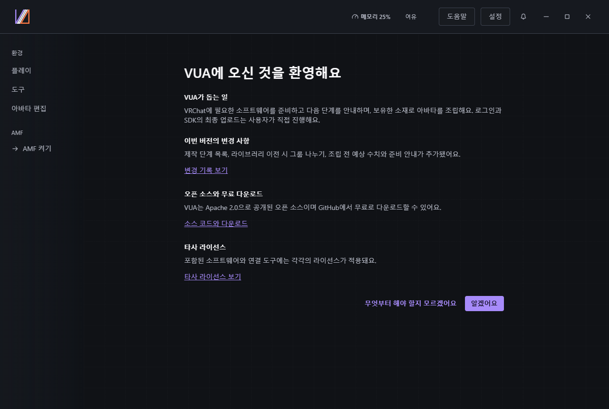
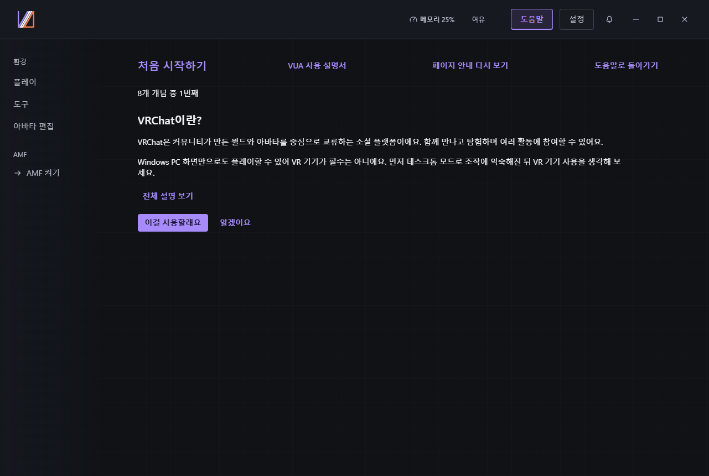
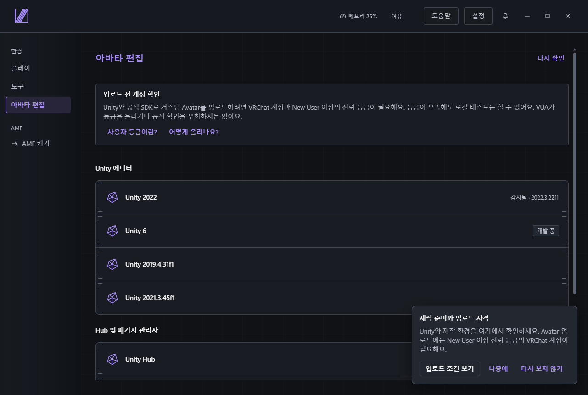
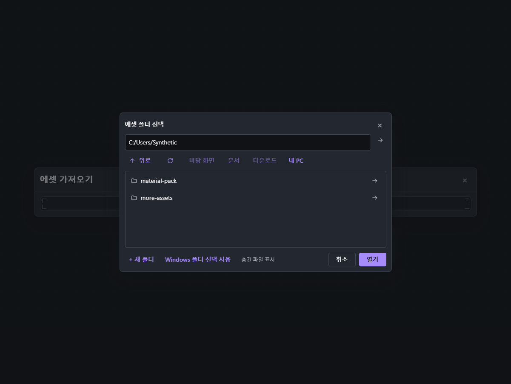
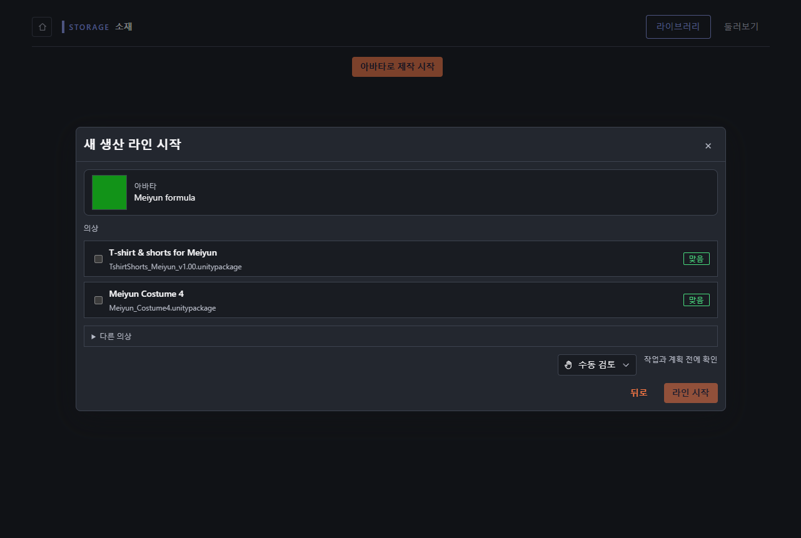
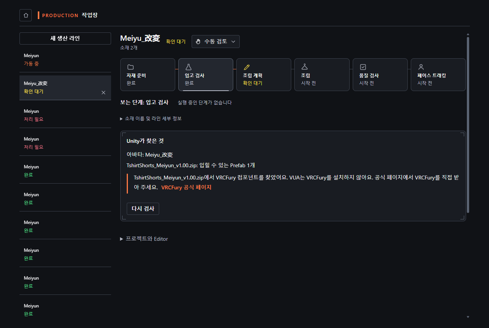
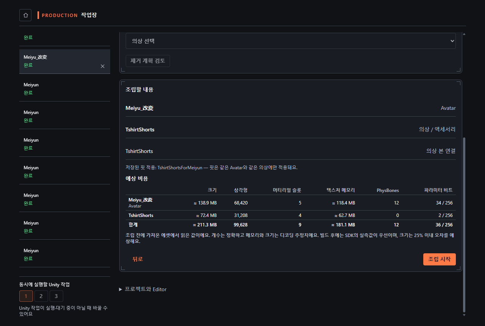
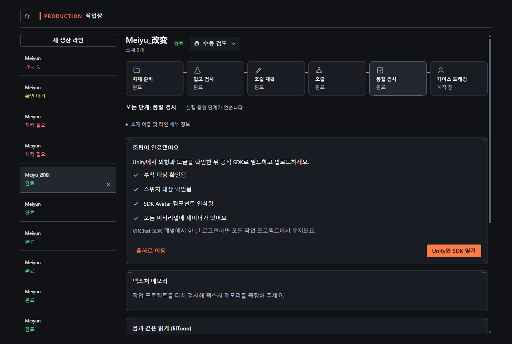
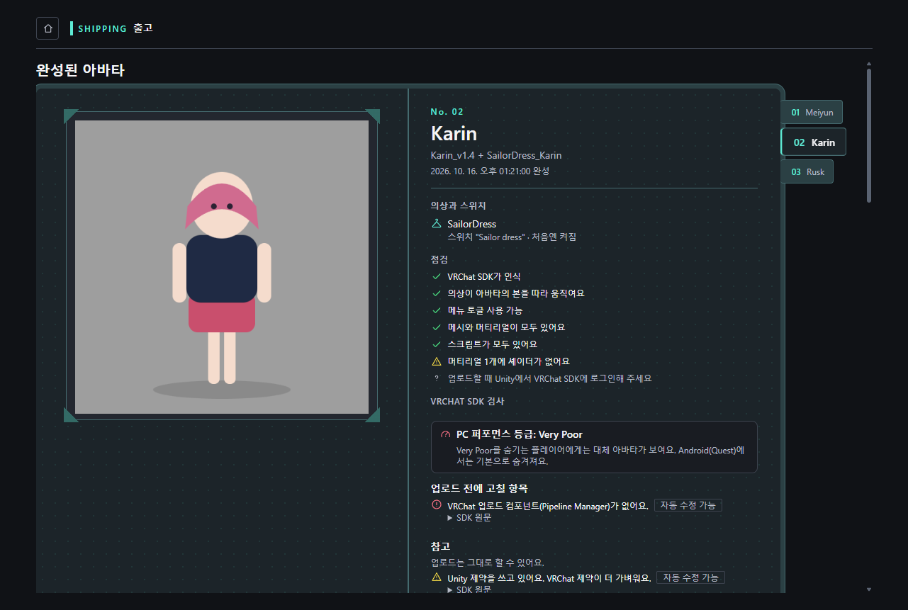

# 설치부터 VRChat SDK 넘기기까지

> 버전: Virtual Unified Assistant 1.0.0 · AMF 0.3.0 Beta
> 상태: 후보 안내서. awaiting native review(원어민 검토 대기), 깨끗한 VM에서 전체 절차 검수 대기

[언어 및 스크린샷 출처](README.md)

시작하기 전에 Windows x64 PC와 각 제작자의 이용 약관에 따라 정당하게 준비한 베이스 아바타(소체) 원본 패키지 1개, 그리고 그 아바타에 맞는 호환 의상 1벌을 준비해 주세요.
아래 화면 캡처는 예시 기록과 임시 미리보기를 사용한 것으로, 실제 아바타 검수 결과가 아니에요. 1.0.0 설치 파일은 현재 준비 중이므로, 대응하는 배포 빌드나 작성자가 지정한 테스트 패키지로 진행해 주세요.

## 1. VUA 설치하고 실행하기

인터넷 연결이 원활하면 용량이 작은 온라인 설치 파일을, 실행 환경까지 한 번에 설치하려면 오프라인 설치 파일을 실행해요. 설치가 끝나면 Windows 시작 메뉴에서 VUA를 열어요.
Unity Hub나 SteamVR 같은 외부 프로그램은 각 공식 배포처에서 직접 설치해요. 0.7.0 버전에서 업데이트할 때는 진행 중인 작업을 먼저 마치고 VUA를 완전히 종료해 주세요(업데이트 시 데이터 보존 여부는 아직 검증 대기 중이에요).
설치나 실행에 실패하면 설치 파일 버전과 오류 내용을 기록해 두고, 이전 버전으로 대신 진행해 완료 처리하지 마세요. 실제 설치 과정 캡처는 깨끗한 VM에서 촬영할 예정이에요.

## 2. 첫 실행 안내 확인하기

첫 실행 안내는 시스템 언어에 맞춰 열리며 VUA의 목적, 업데이트 방식, 소스 코드 및 다운로드 경로, 라이선스를 차례대로 안내해요.
확인을 누르면 언제든 건너뛸 수 있는 기능 둘러보기로 넘어가요. 기초부터 차근차근 알아보고 싶다면 입문 가이드를 선택해 ‘VRChat이란?’부터 한 페이지에 개념 하나씩 살펴볼 수 있어요. 각 화면에서 바로 준비 화면으로 이동하거나 다음 개념 설명으로 넘어가면 돼요.
입문 가이드와 기능 둘러보기는 ‘도움말’에서 언제든 다시 열 수 있고, 표시 언어는 ‘설정’에서 바꿀 수 있어요.

## 3. 아바타 개변 환경 준비하기

‘환경 → 아바타 편집’ 화면을 열고 Unity Hub와 안내된 권장 Unity 에디터 버전이 준비되어 있는지 확인해요.
라이선스 안내 단계에 따라 Unity Hub에서 로그인하고 라이선스를 활성화한 뒤, VUA로 돌아와 다시 확인해 주세요.
AMF 모듈이 꺼져 있다면 먼저 켜 주세요. 필수 프로그램이 빠져 있다면 공식 안내 링크를 따라 설치를 마친 뒤 다음 단계로 넘어가요.

## 4. 원본 소재 파일 가져오기

AMF 소재함의 가져오기 메뉴에서 베이스 아바타와 의상의 `.unitypackage` 파일(또는 들어 있는 폴더)을 고르고, 인식된 내용을 확인한 뒤 가져와요.
기존에 모아 둔 소재 폴더 전체를 한꺼번에 정리할 때는 마이그레이션 도구로 폴더와 낱개 파일을 묶고, 미할당·제외·읽기 불가 항목을 정리한 뒤 확인한 묶음만 가져오세요(미리보기만 열어서는 가져오지 않아요).
VRCFury 같은 선행 패키지 안내가 표시되면 공식 링크를 따라 설치를 마친 뒤 돌아오면 돼요.

## 5. 의상 입히기 작업 시작하기

소재함에서 베이스 아바타 상세 화면을 열고 ‘소체로 사용’을 고른 뒤, 호환되는 의상 한 벌을 선택해 작업을 시작해요.
작업장은 원본 `.unitypackage` 파일을 건드리지 않고 별도의 Unity 작업 프로젝트를 새로 준비해요. 이번 절차에서는 기본값인 ‘변경 전 확인’ 모드를 그대로 사용해 주세요.
원하는 소재가 목록에 보이지 않으면 로컬 파일 가져오기가 끝났는지 먼저 확인해 주세요.

## 6. 인식된 Prefab 확인하기

준비가 끝나면 점검 화면에서 베이스 아바타와 의상 Prefab, 그리고 추천 이유를 확인해요.
빠진 스크립트나 셰이더, 필수 패키지가 있다면 화면에 안내된 절차대로 먼저 해결한 뒤 진행해 주세요. 막히거나 실패한 단계는 자동으로 통과되지 않으니 조치 후 다시 점검해야 해요.

## 7. 조립 계획과 예상 수치 확인 후 실행하기

의상 장착 방식과 메뉴 설정을 비롯해 용량, 폴리곤(삼각형) 수, 머티리얼 슬롯, 텍스처 메모리, PhysBones, 파라미터 비트 수까지 여섯 가지 예상 수치를 확인해요.
수치는 원본 소재 기준 추정치이며, 텍스처 메모리는 압축 해제 기준 예상값이고 비압축 크기에는 25% 허용 오차가 표시돼요(VRChat SDK나 비파괴 도구가 빌드할 때 생성·변경하는 내용에 따라 실제 값과 달라질 수 있어요).
내용을 확인한 뒤 계획을 승인해 조립을 시작하고 완료될 때까지 기다려요.

## 8. 완성 결과와 품질 점검 확인하기

조립이 끝나면 품질 점검 요약과 앞·옆·뒤 미리보기를 확인해요. 실행하지 않았거나 실패한 항목은 통과로 인정되지 않아요.
직접 수정하거나 눈으로 꼼꼼히 살펴봐야 할 부분이 있다면 Unity에서 작업 프로젝트를 열어 조정한 뒤 다시 점검을 실행해 주세요.
도중에 멈추더라도 작업 라인과 복원 지점이 유지되므로, 원인을 해결한 뒤 화면에 표시된 계속하기·다시 시도 버튼으로 이어서 진행할 수 있어요.

## 9. VRChat SDK로 넘겨 마무리하기

‘완성된 아바타’ 화면에서 방금 마친 작업을 선택하고 SDK 점검 안내를 살펴봐요. 업로드를 막는 오류를 먼저 해결하고, SDK의 자동 수정(Auto Fix)은 어떤 항목이 바뀌는지 이해할 수 있을 때만 사용해 주세요.
이어서 Unity에서 해당 작업 프로젝트와 VRChat SDK 패널을 열어 외형, 표정·토글 동작, 대상 플랫폼(PC / Quest)을 확인해요.
VRChat 로그인 상태나 신뢰 등급(`New User` 이상 필요) 때문에 업로드가 막혀 있다면 화면에 연결된 업로드 자격 안내를 확인해 해결한 뒤 돌아와 주세요.

프로젝트를 VRChat SDK 패널에서 검토할 수 있는 상태까지 열었다면 이 안내서의 절차는 모두 끝나요. 업로드하기 전에는 반드시 결과물을 직접 확인하고 포함된 모든 소재의 이용 권한을 갖추었는지 점검해 주세요.
VUA의 업로드 안내 흐름을 쓰더라도 사용자의 명시적 확인이 필요하며, 실제 빌드와 업로드는 공식 VRChat SDK가 수행해요. 예시 스크린샷이나 자동 기술 점검만으로는 VRChat 안에서의 실제 모습과 동작을 보장할 수 없어요.
