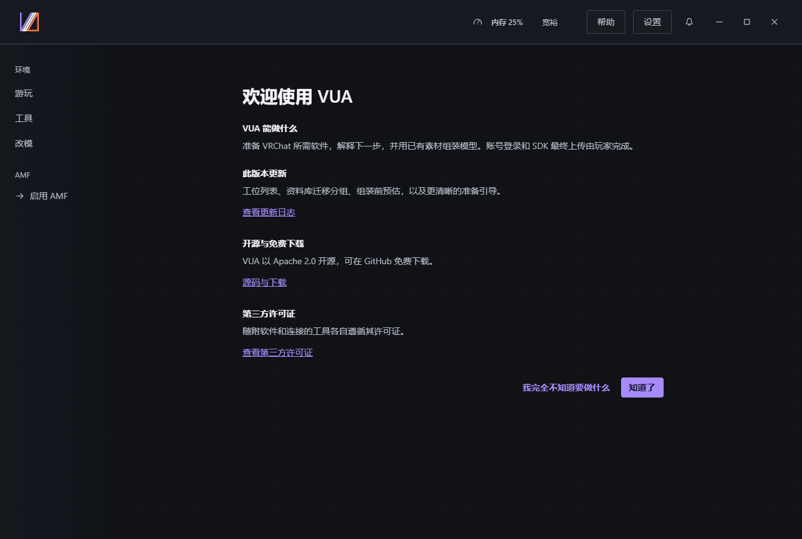
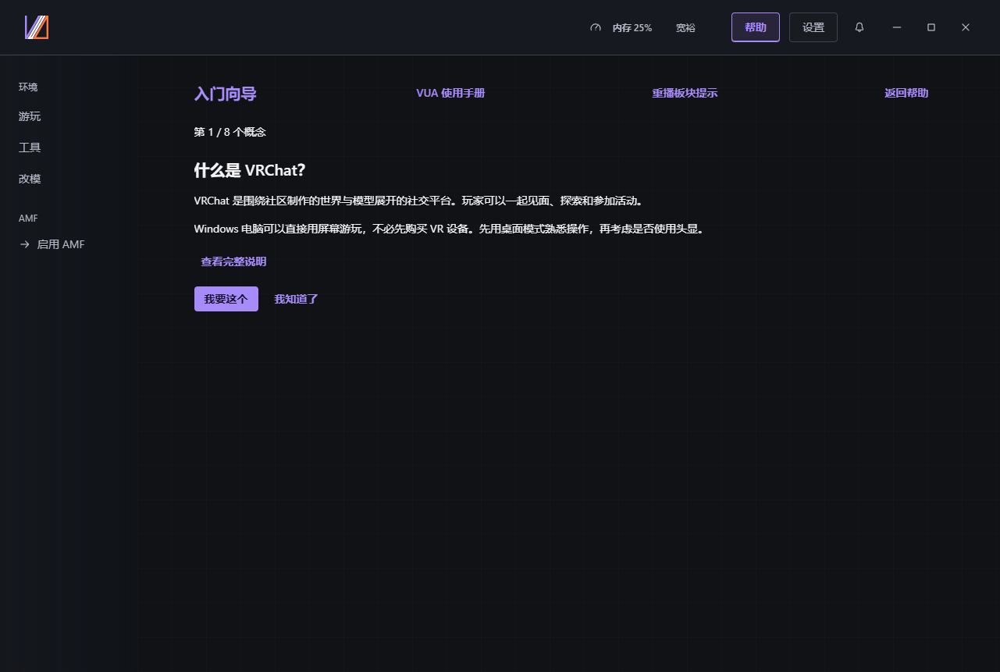
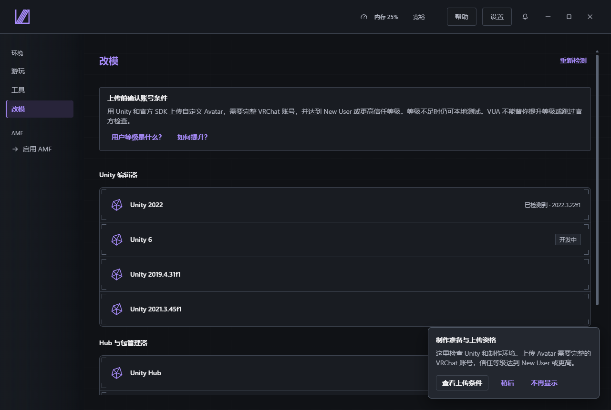
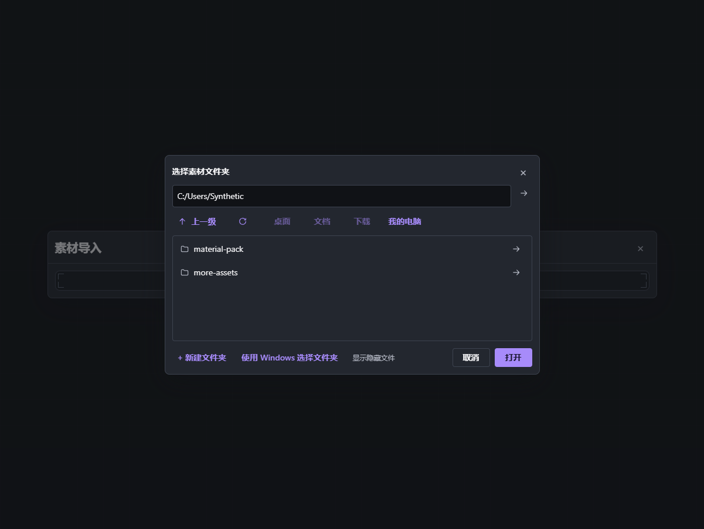
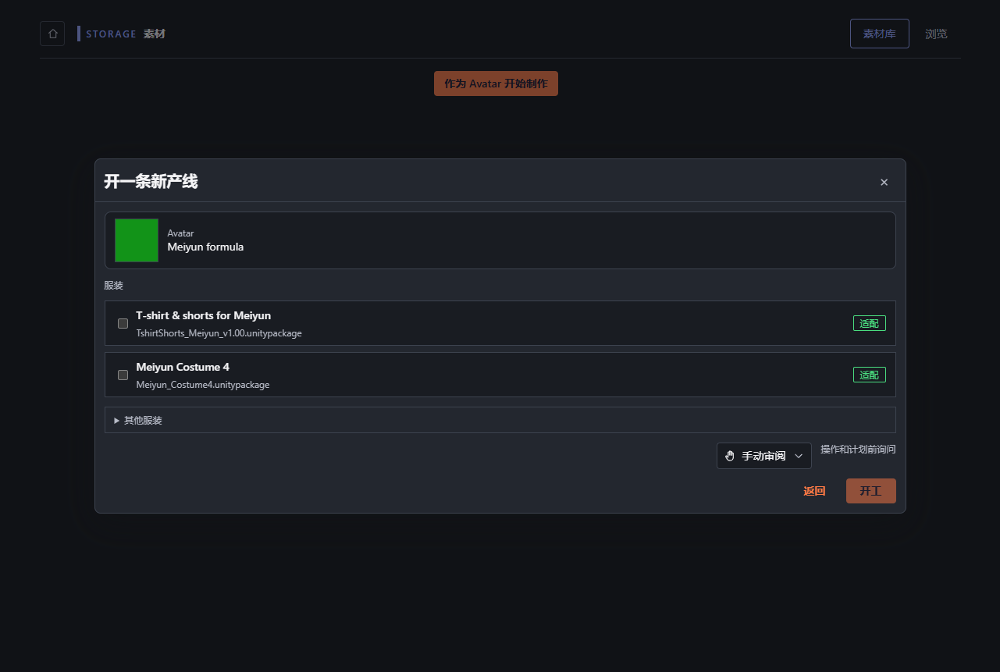
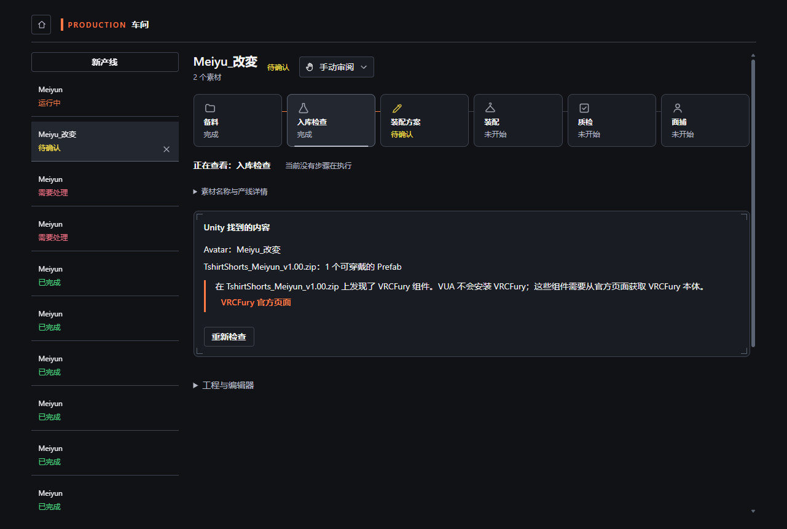
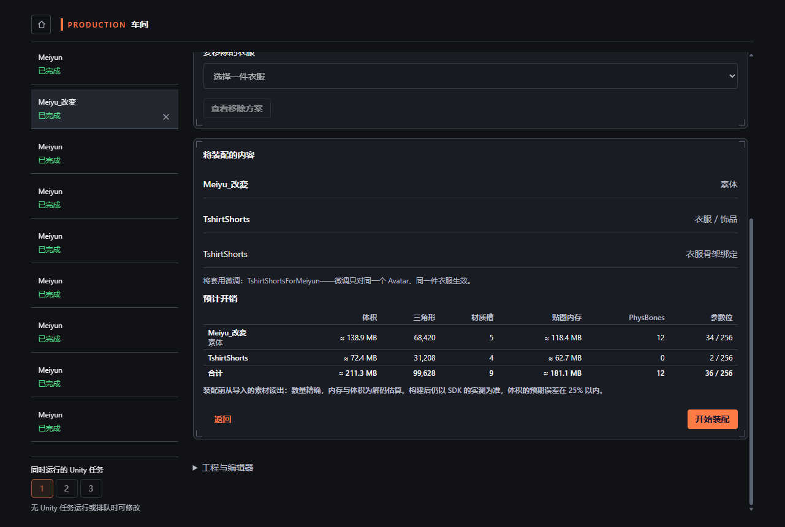
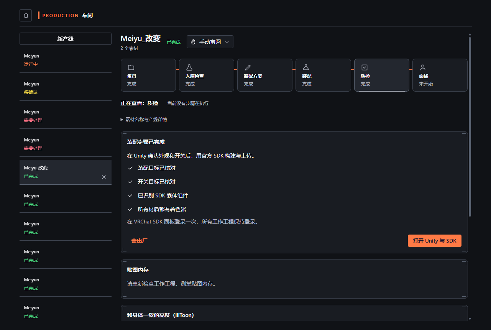
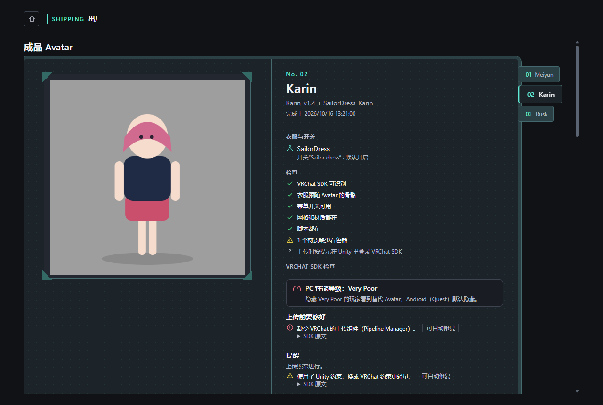

# 从安装到交接 VRChat SDK

> 版本：Virtual Unified Assistant 1.0.0 · AMF 0.3.0 Beta
> 状态：候选指南；awaiting native review（待母语审校），待干净虚拟机通读验收

[语言与截图来源](README.md)

开始前请准备一台 Windows x64 电脑、一份合法取得的素体原始包，以及一套对应它的服装素材，并遵守原作者的使用条款。
文内配图使用示例条目与占位预览，不代表已完成真实模型的验收。1.0.0 正式安装包仍在准备中，请配合对应的发布构建或作者指定的测试包按本流程操作。

## 1. 安装并启动 VUA

网络顺畅时推荐使用体积更小的在线安装程序；需要随包自带运行环境时可使用离线安装包。安装完成后从 Windows 开始菜单启动 VUA。
Unity Hub、SteamVR 等外部软件仍通过各自官方渠道下载安装。若从 0.7.0 升级，请先完成手头的制作任务并完全退出 VUA（跨版本数据保留仍在验证中）。
如果安装或启动报错，请记录安装包版本号与错误现象，不要改用旧版本继续充当验收结果。安装向导实拍图待作者在干净虚拟机中采集补充。

## 2. 选择首次启动入口

首次启动说明会自动匹配系统语言，依次介绍软件用途、更新方式、源码与下载渠道以及开源许可。
点击“知道了”可进入功能导览（随时可跳过）；若完全没接触过相关概念，可选择新手入门入口，从“什么是 VRChat”开始逐页了解基础概念——想立即配置某项就点“我要这个”，只想继续往下看就点“我知道了”。
之后随时可在“帮助”中重开入门向导与导览，或在“设置”中切换界面语言。

## 3. 准备改模环境

前往“环境 → 改模”，检查 Unity Hub 与当前推荐的 Unity 编辑器版本是否就绪。
按页面许可证步骤的指引在 Unity Hub 中登录账号并激活许可证，完成后回到 VUA 重新检测。
如果 AMF 模块尚未开启，请先将其启用；若缺少其他前置软件，请先按官方指引安装配置妥当，再开始穿衣组装。

## 4. 导入原始素材包

打开 AMF 素材库的“导入”菜单，选择素体与服装的 `.unitypackage` 文件或所在文件夹，核对识别出的内容后确认导入。
如果要一次性整理旧素材文件夹，可使用迁移功能逐个文件夹划分归属、为散落文件分组，并在处理完未分配、已排除与无法读取的项目后，仅导入已确认的分组（单纯点开预览不会触发导入）。
若服装说明要求安装 VRCFury 等扩展工具，请按页面提供的官方链接完成安装后再返回继续。

## 5. 新建一条穿衣组装流程

点开素体的素材详情，选择“作为 Avatar 开始制作”，勾选一套适配该素体的服装后点击“开工”。
车间会为这次组装单独创建一份 Unity 工作工程，不会改动你原本保存的 `.unitypackage` 素材包。本次请保持默认的“手动审阅”（操作和计划前询问）模式。
如果列表里看不到可用素材，请先确认对应的本地文件已完成导入。

## 6. 核对识别出的预制体（Prefab）

等待环境与工程准备完成后，在检查环节核对系统识别出的素体与服装 Prefab，并查看推荐理由。
若提示缺少脚本、着色器（Shader）或前置依赖包，请先按页面给出的操作补齐并重新检查；未通过或被阻断的步骤不会自动放行。

## 7. 核对组装计划与性能预估

确认服装挂载方式、开关菜单选项，以及文件大小、三角面数、材质槽数、贴图显存、动骨（PhysBones）和表情参数位这六项预估指标。
其中各项数量基于源素材估算，贴图显存按解码后占用推算，未压缩体积留有 25% 浮动范围；经过 VRChat SDK 或非破坏式插件构建后实际数值可能有所出入。
核对无误后确认计划并开始组装，等待运行完成。

## 8. 查看组装结果与质检报告

组装完成后查看质量检查结果，并切换正面、侧面与背面预览图核对外观。未运行或未通过的检查项不算达标。
如果需要手动微调或进场景细看，可在 Unity 中打开工作工程，调整完毕后回到 VUA 重新检查。
若中途被打断，系统会保留当前进度与还原点；排除问题后按页面提示选择继续或重试即可。

## 9. 交接到 VRChat SDK 检查上传

打开“出厂”页的“成品 Avatar”选中刚刚完成的记录，查看 SDK 检查提示。请先解决阻断上传的报错；仅在明确了解改动内容时再点击 SDK 提供的“自动修复（Auto Fix）”。
随后在 Unity 中打开对应工作工程与 VRChat SDK 面板，确认角色外观、表情开关与目标平台（PC 或 Quest 一体机）均正常。
若因未登录 VRChat 账号或信任等级（需达到 `New User`）暂无法上传，请参考页面上的上传资格说明处理后再返回。

当工程顺利交接至 VRChat SDK 面板可供最终核对时，本指南流程即告完成。请务必在亲自检查成品表现并确认拥有所含全部素材的使用权后再执行上传。
即使使用 VUA 的引导上传流程，也必须经过你的明确确认，并由官方 VRChat SDK 完成实际打包与上传，请如实记录最终结果。示例截图与自动技术检查均无法代替你在游戏内核对模型的实际外观与表现。
