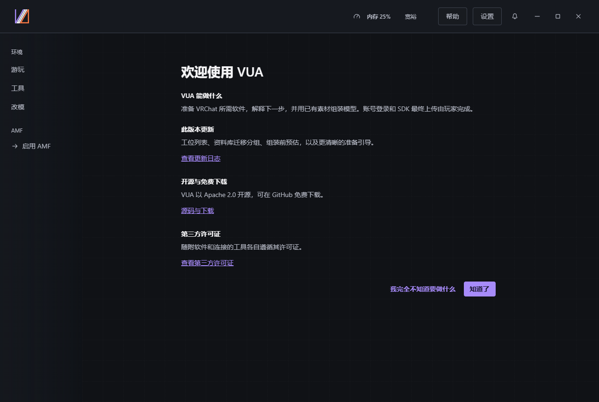
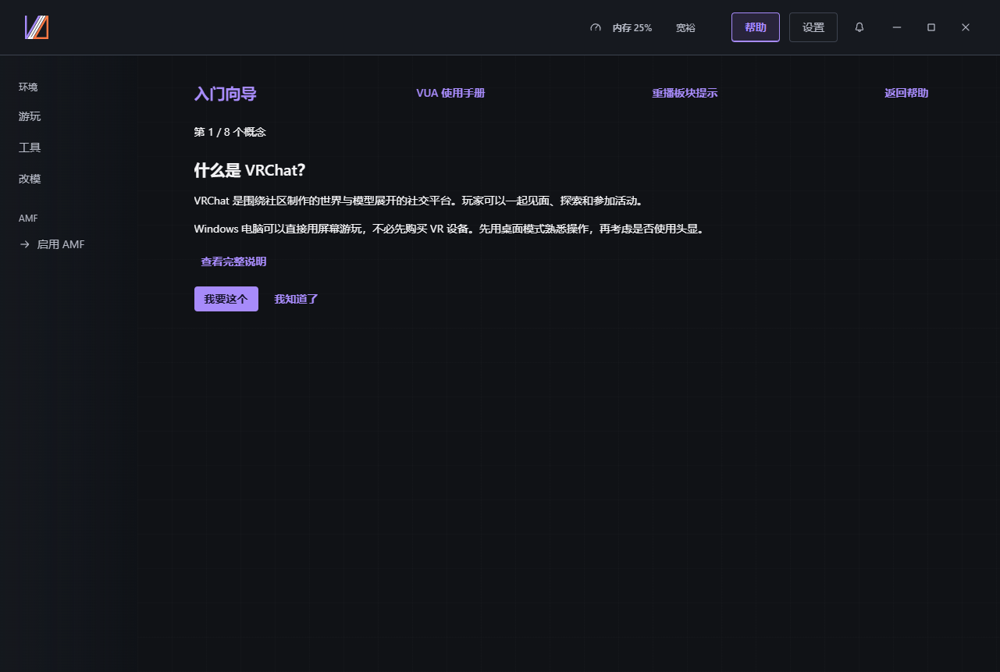
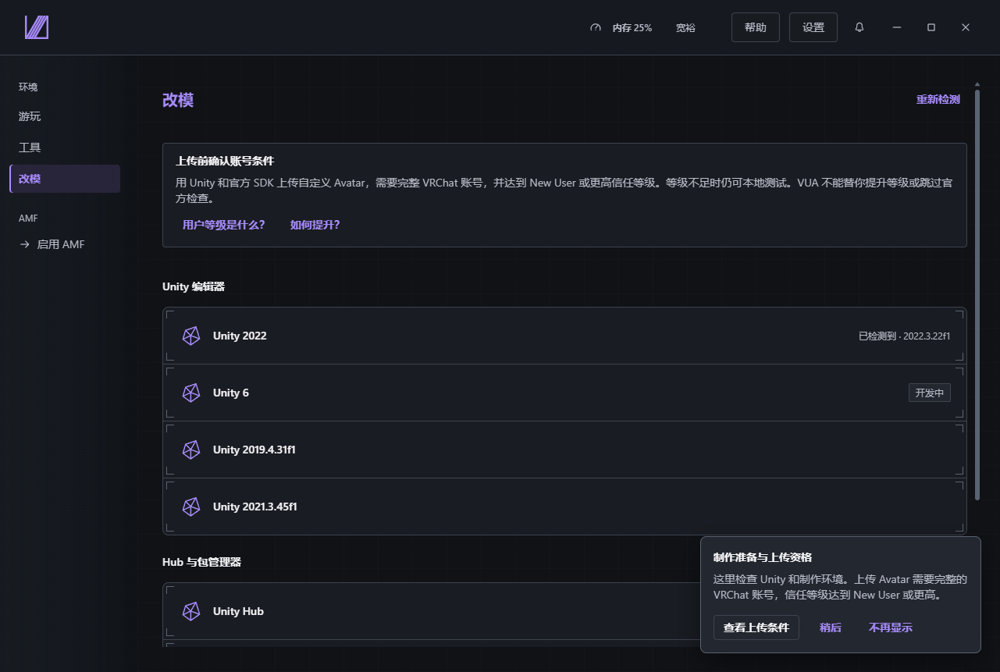
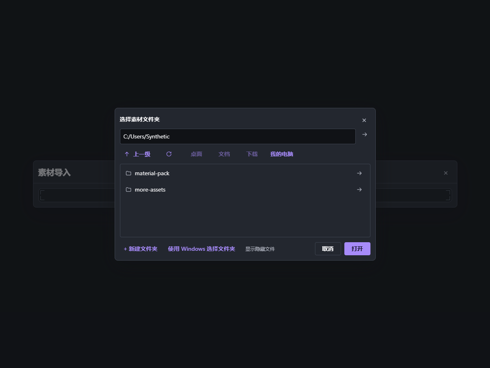
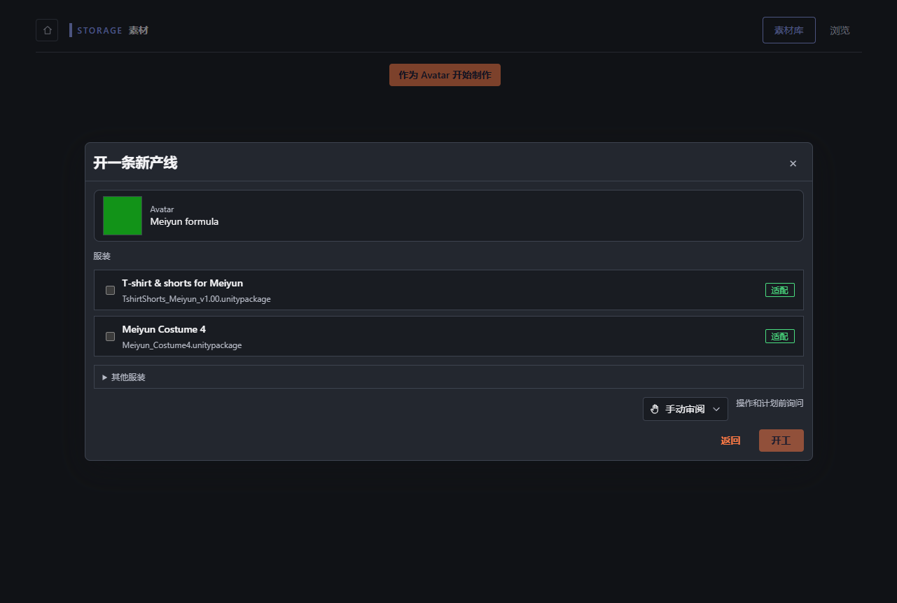
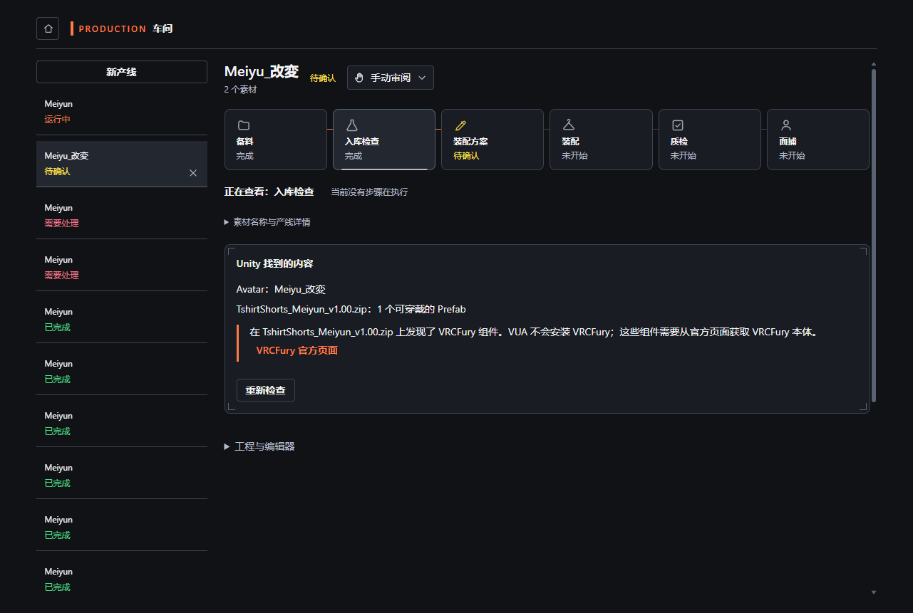
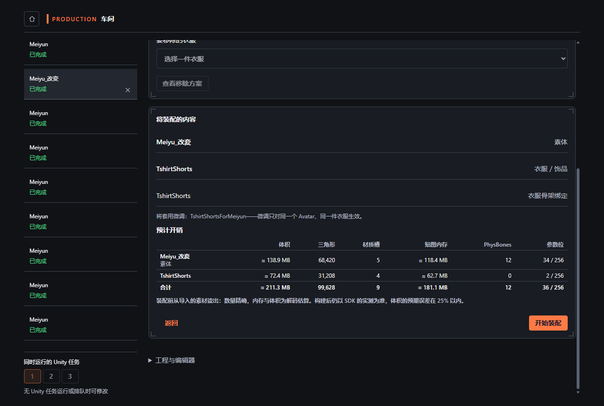
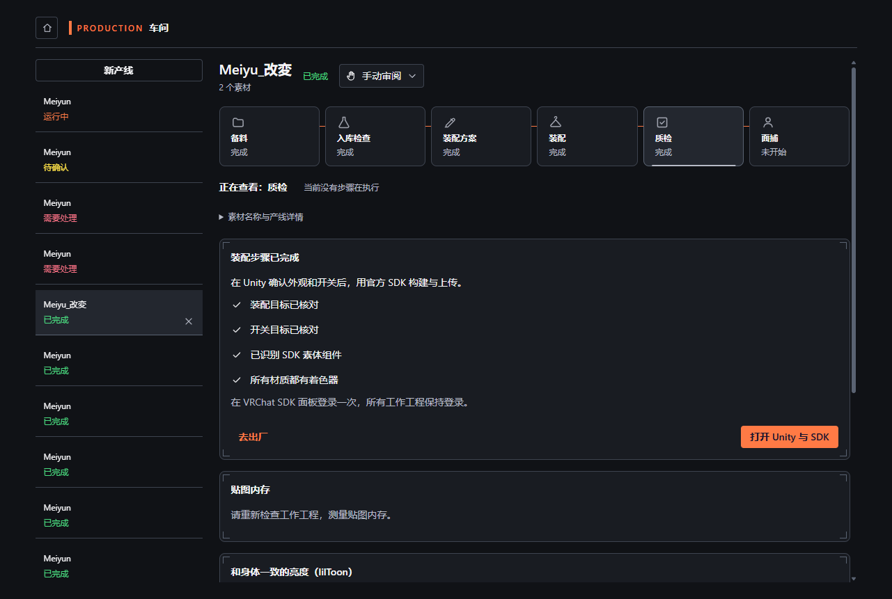
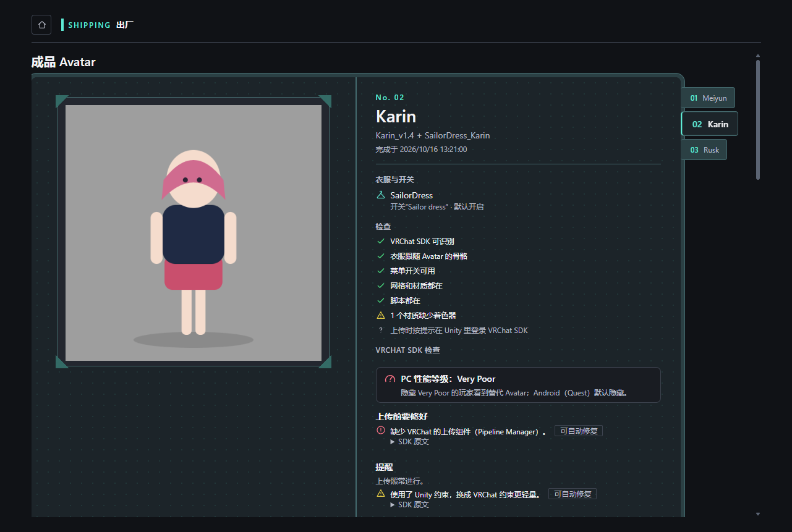

# 从安装到 SDK

> 版本：Virtual Unified Assistant 1.0.0 · AMF 0.3.0 Beta
> 状态：候选指南；awaiting native review（待母语审校），待干净虚拟机通读验收

[语言与截图来源](README.md)

准备 Windows x64、一份 Avatar 原始包和一套适配它的衣服，并按各自许可取得和使用。
截图使用示例记录与替代预览，不代表真实 Avatar 已验收。1.0.0 安装器仍在准备；
请使用对应的正式发布构建或作者指定的测试包。

## 1. 安装并打开 VUA

下载顺畅时用在线安装器，需要随包携带运行时时用离线安装器。安装后从开始菜单打开 VUA。
外部软件仍从各自官方来源取得。从 0.7.0 升级前先完成制作并退出；升级数据保留尚待验证。
安装或启动失败时记录安装包版本和失败情况，不用旧版继续冒充完成。安装器图片待作者在真实干净虚拟机上采集。

## 2. 选择首次使用入口

首次使用说明跟随系统语言。阅读用途、更新、源码下载与许可四部分。
「知道了」进入可跳过的功能导览；「我完全不知道要做什么」从「什么是 VRChat」开始，每页介绍一个概念。
「我要这个」进入对应准备页面，「我知道了」阅读下一项。帮助可重新打开向导和导览，设置可切换语言。

## 3. 准备改模环境

打开「环境 → 改模」，检查 Unity Hub 与页面提供的 Editor 版本。按许可证步骤的下一项操作，
在 Unity Hub 中登录或激活，返回后重新检查。AMF 关闭时先启用。
缺少前置软件时完成对应官方流程，再开始产线。

## 4. 导入原始素材

打开 AMF 素材库的导入菜单，选择 Avatar、衣服的包文件或所在文件夹，检查识别内容后确认导入。
迁移整个旧素材库时，逐目录处理并为散文件分组，处理未分配、已排除和不可读区域后，只导入已确认的组。
打开预览不会导入。需要 VRCFury 等引导取得的依赖时，按官方链接完成后返回。

## 5. 开始一条产线

打开 Avatar 的素材详情，选择作为 Avatar 使用，勾选一套适配衣服，再开始产线。
车间为该产线准备单独的 Unity 工作工程，原始包保持不变。本次按默认的「修改前询问」模式操作。
没有可用素材时，先补齐本地文件的导入。

## 6. 核对识别结果

等待准备结束，在检查工位核对 Avatar 和衣服的 Prefab，阅读推荐原因。
先处理缺失脚本、着色器或依赖，再继续。被阻断、失败的步骤仍未通过；按显示的操作解决后重新检查。

## 7. 确认计划并装配

核对衣服、绑定与菜单选项，以及体积、三角面数、材质槽、纹理显存、PhysBones、参数位六项预测。
计数依据源内容，纹理显存采用解码估计，未压缩体积标有 25% 容差；SDK 生成或改动的内容可能不同。
审阅计划并批准装配，等待实际结果。

## 8. 检查结果

阅读完成产线的质检结果，查看正、侧、背面预览。未运行或失败的检查不算通过。
需要修改或目视检查时，在 Unity 打开工作工程，处理后重新检查。
中断时保留产线与恢复点，排除阻塞后使用页面显示的继续或重试操作。

## 9. 交接到 SDK

打开成品页并选中该产线，阅读 SDK 检查。先修复阻塞错误；仅在提供且理解操作时使用 SDK 自动修复。
在 Unity 打开对应工程及 VRChat SDK 面板，检查外观、行为与目标平台。
登录或信任等级阻止上传时，按页面的上传资格说明处理后返回。

该工程到达 SDK、可供检查时，本次操作完成。检查结果并确认内容权利后才上传。
VUA 的受管上传仍需明确确认，由官方 SDK 构建和上传，记录实际结果。
示例截图或技术检查不能保证 Avatar 在 VRChat 中的外观与行为。
