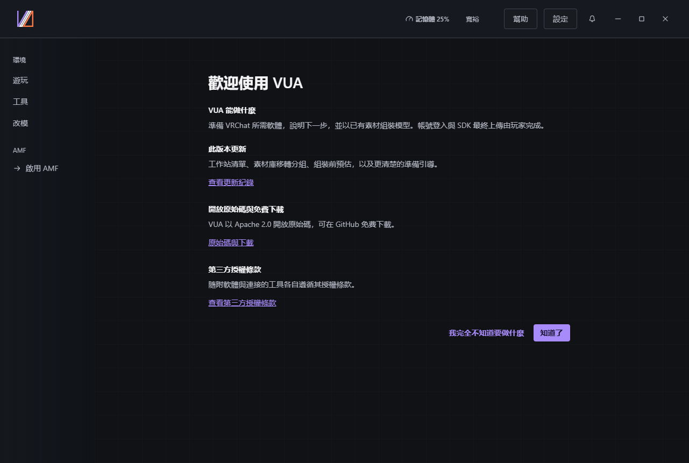
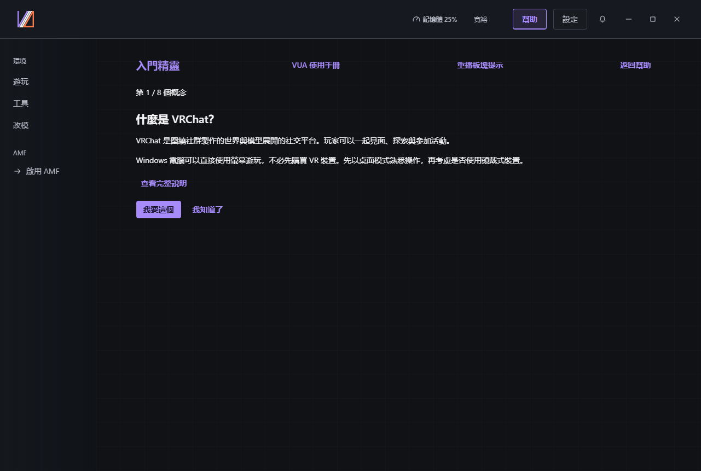
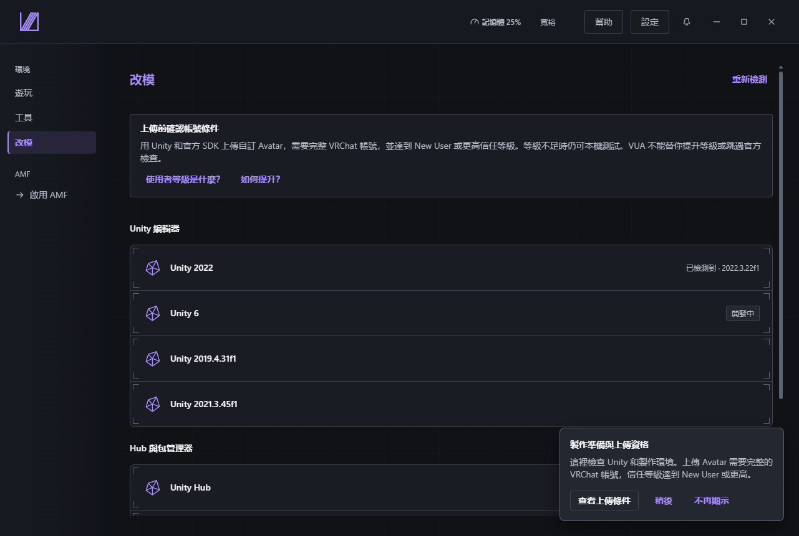
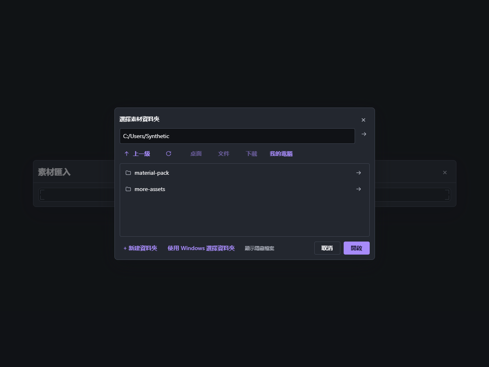
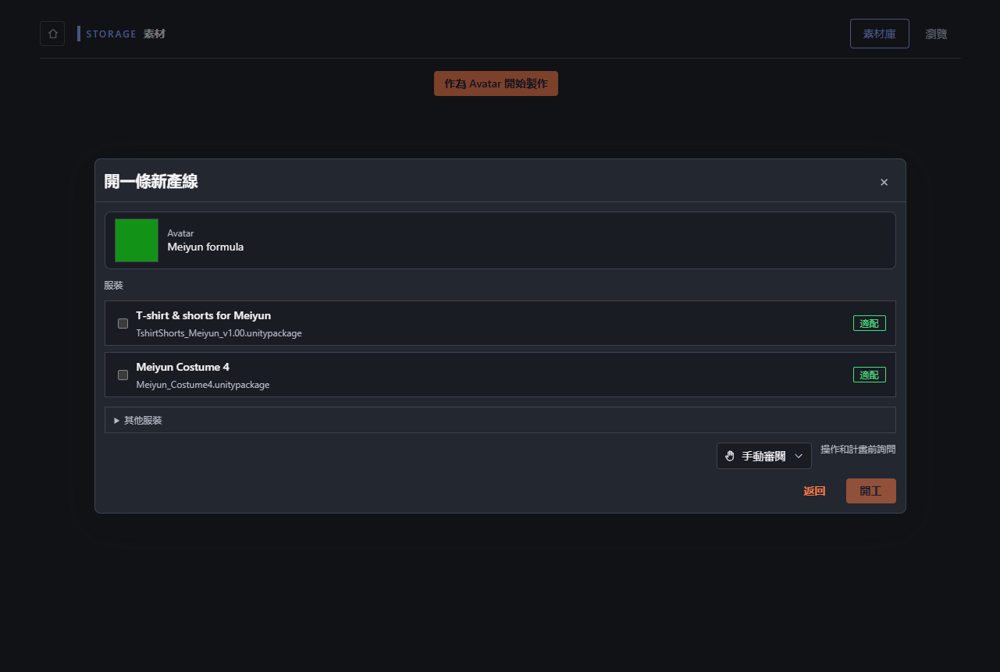
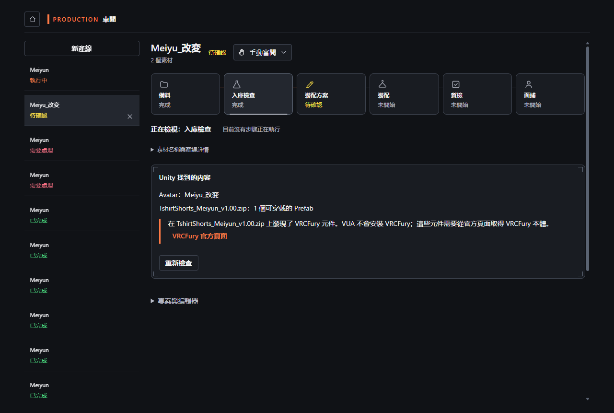
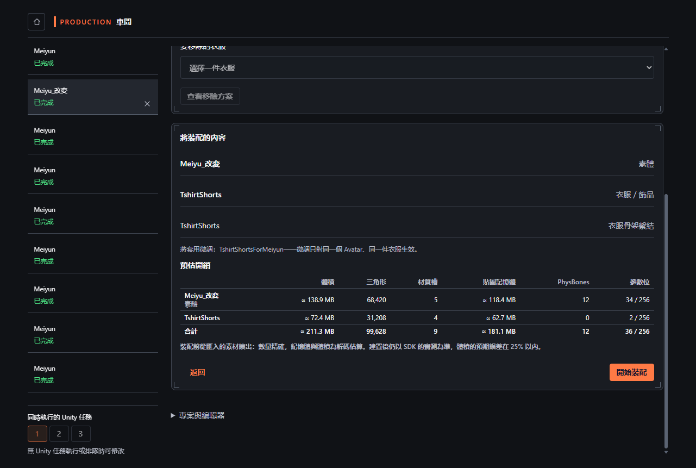
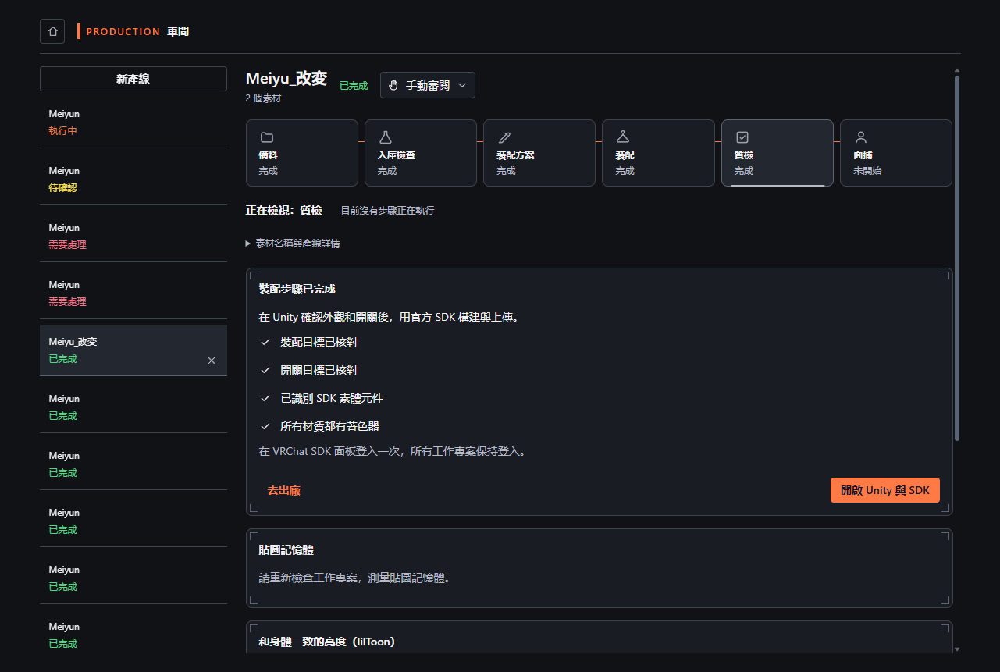
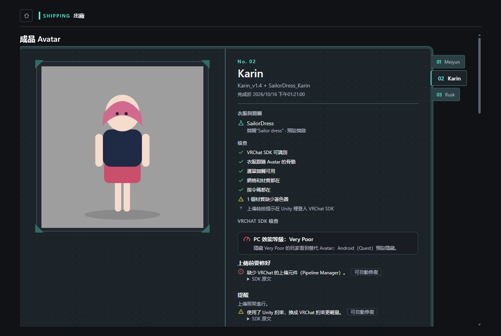

# 從安裝到 SDK

> 版本：Virtual Unified Assistant 1.0.0 · AMF 0.3.0 Beta
> 狀態：候選指南；awaiting native review（繁體中文待母語審校），待乾淨虛擬機器通讀驗收

[語言與截圖來源](README.md)

準備 Windows x64、一份 Avatar 原始套件及一套適用的服裝，並依各自授權取得及使用。
截圖使用範例紀錄與替代預覽，不代表真實 Avatar 已通過驗收。1.0.0 安裝程式仍在準備；
請使用對應的正式發佈組建或作者指定的測試套件。

## 1. 安裝並開啟 VUA

下載順暢時使用線上安裝程式，需要內含執行環境時使用離線安裝程式。
安裝後從開始功能表開啟 VUA，外部軟體仍從各自官方來源取得。
從 0.7.0 升級前先完成製作並結束 VUA；升級資料保留尚待驗證。
安裝或啟動失敗時記錄版本與狀況，不以舊版冒充完成。安裝圖片待作者在真實乾淨虛擬機器上擷取。

## 2. 選擇首次使用入口

首次使用說明跟隨系統語言，包含用途、更新、原始碼下載與授權四部分。
確認後進入可略過的功能導覽；初學者入口從「什麼是 VRChat」開始，每頁介紹一個概念。
想使用該項目時進入對應準備頁，已了解則閱讀下一項。說明可重新開啟精靈和導覽，設定可切換語言。

## 3. 準備 Avatar 編輯環境

開啟環境中的 Avatar 編輯頁，檢查 Unity Hub 與頁面提供的 Editor 版本。
依授權步驟顯示的下一個操作，在 Unity Hub 登入或啟用，返回後重新檢查。
AMF 關閉時先啟用；缺少前置軟體時完成對應官方流程後再開始產線。

## 4. 匯入原始素材

開啟 AMF 素材庫的匯入選單，選擇 Avatar、服裝套件檔案或所在資料夾，檢查辨識內容後確認匯入。
移轉整個舊素材庫時，逐資料夾處理並為散落檔案分組，處理未指派、已排除和無法讀取區域後，
只匯入已確認的群組。開啟預覽不會匯入。需要 VRCFury 等引導取得的相依套件時，依官方連結完成後返回。

## 5. 開始一條產線

開啟 Avatar 素材詳細資料，選擇作為 Avatar 使用，勾選一套相容服裝，再開始產線。
工作坊為該產線準備獨立 Unity 工作專案，原始套件保持不變。本次使用預設的修改前詢問模式。
沒有可用素材時，先完成本機檔案的匯入。

## 6. 核對辨識結果

等待準備結束，在檢查工位核對 Avatar 與服裝的 Prefab，閱讀建議原因。
先處理遺失腳本、著色器或相依套件再繼續。受阻或失敗的步驟尚未通過，依顯示的操作解決後重新檢查。

## 7. 確認計畫並組裝

核對服裝、綁定和選單選項，以及大小、三角形數、材質槽、紋理記憶體、PhysBones、參數位元六項預測。
計數依據來源內容，紋理記憶體採解碼估算，未壓縮大小標有 25% 容許差；
SDK 產生或變動的內容可能不同。審閱計畫並核准組裝，等待實際結果。

## 8. 檢查結果

閱讀完成產線的品質檢查結果，查看正面、側面和背面預覽。未執行或失敗的檢查不算通過。
需要修改或目視檢查時，在 Unity 開啟工作專案，處理後重新檢查。
中斷時保留產線與還原點，排除阻礙後使用畫面顯示的繼續或重試操作。

## 9. 交接到 SDK

開啟成品頁並選取該產線，閱讀 SDK 檢查。先修復阻礙上傳的錯誤；
僅在提供且理解操作時使用 SDK 自動修復。在 Unity 開啟對應專案及 VRChat SDK 面板，
檢查外觀、行為與目標平台。登入或信任等級限制上傳時，依上傳資格說明處理後返回。

專案到達 SDK、可供檢查時，本次操作完成。確認結果及內容權利後才上傳。
VUA 的受管上傳需要明確確認，由官方 SDK 建置及上傳，記錄實際結果。
範例截圖或技術檢查無法保證 Avatar 在 VRChat 中的外觀與行為。
