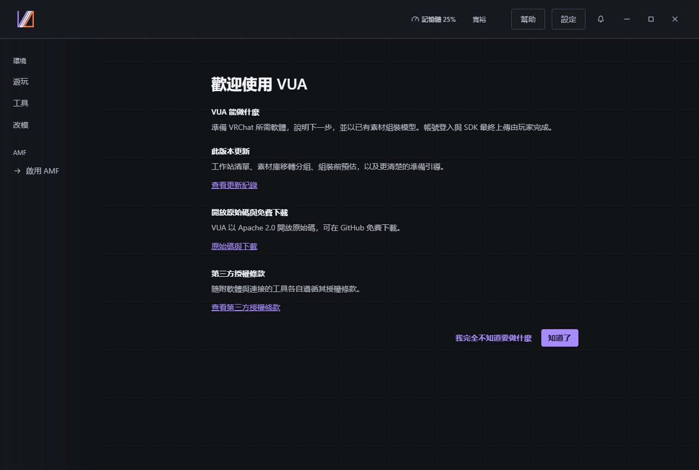
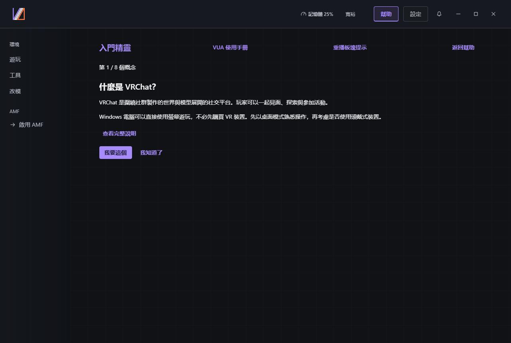
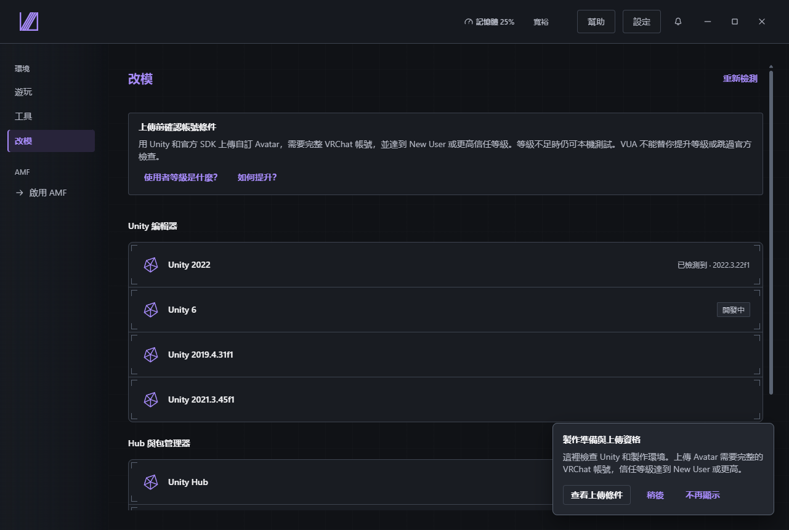
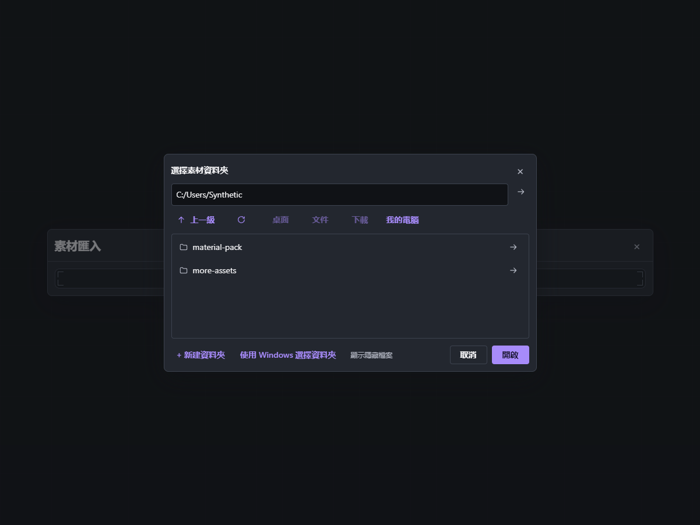
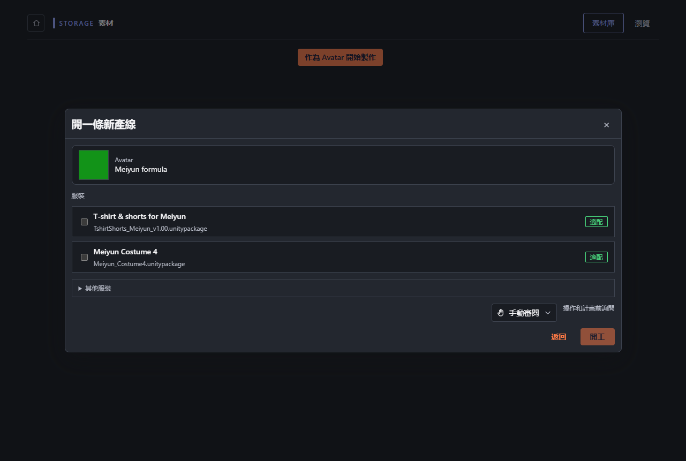
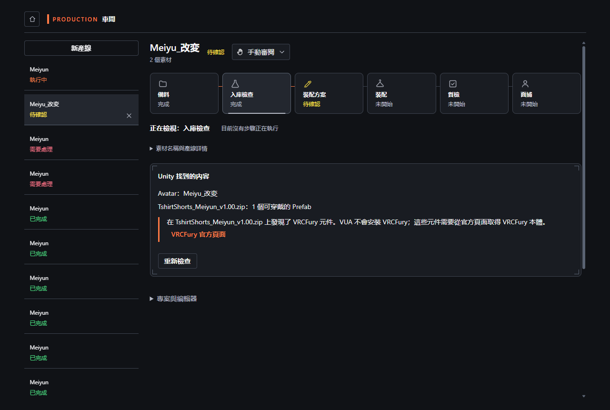
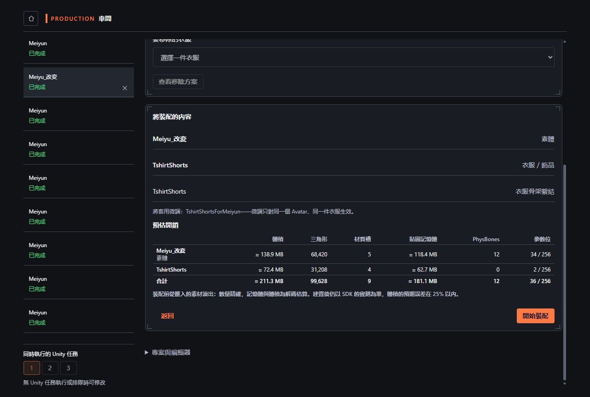
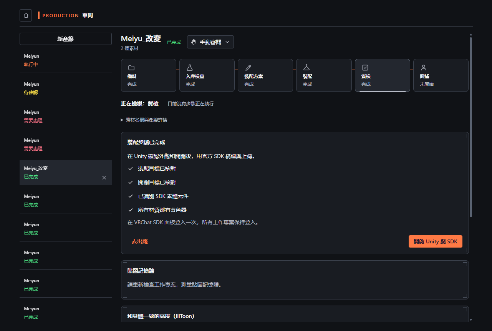
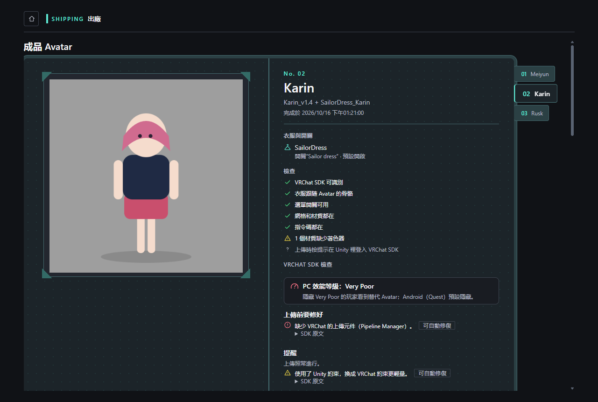

# 從安裝到交接 VRChat SDK

> 版本：Virtual Unified Assistant 1.0.0 · AMF 0.3.0 Beta
> 狀態：候選指南；awaiting native review（繁體中文待母語審校），待乾淨虛擬機器通讀驗收

[語言與截圖來源](README.md)

開始前請準備一台 Windows x64 電腦、一份依原作者規範合法取得的素體原始套件，以及一套對應此素體的服裝素材。
文內截圖皆使用範例資料與示意預覽圖，不代表已完成真實模型的驗收。1.0.0 正式安裝程式仍在準備中，請搭配對應的公開發佈組建或作者指定的測試包依本流程操作。

## 1. 安裝並啟動 VUA

網路連線穩定時建議使用檔案較小的線上安裝程式；需要隨附完整執行環境時請選用離線安裝包。安裝完成後從 Windows 開始選單開啟 VUA。
Unity Hub、SteamVR 等外部軟體仍由各自官方網站下載安裝。若從 0.7.0 升級，請先完成手邊的製作工作並完全關閉 VUA（跨版本資料保留仍在驗證中）。
若安裝或啟動失敗，請記錄安裝程式版本與錯誤情況，請勿改用舊版本頂替繼續。安裝過程實拍圖待作者於乾淨虛擬機器擷取補齊。

## 2. 選擇首次啟動入口

首次啟動說明會自動依系統語言顯示，依序介紹軟體用途、更新機制、原始碼與下載管道以及授權條款。
點擊確認後會進入功能導覽（可隨時略過）；若完全沒接觸過相關工具，可選擇新手入門引導，從「什麼是 VRChat」開始每頁認識一個概念——想立刻準備該項目可前往對應設定頁，已經了解則繼續看下一頁。
之後隨時可從「說明」重新開啟入門引導與功能導覽，或在「設定」中切換介面語言。

## 3. 準備改模環境

前往「環境 → Avatar 編輯」頁面，檢查 Unity Hub 與畫面列出的推薦 Unity 編輯器版本是否就緒。
依照授權步驟的提示，前往 Unity Hub 登入帳號並啟用免費個人版授權，完成後回到 VUA 重新檢查。
若 AMF 模組尚未開啟，請先將其啟用；若缺少其他前置軟體，請先依官方流程安裝設定完成後再開始組裝。

## 4. 匯入原始素材包

開啟 AMF 素材庫的「匯入」選單，選取素體與服裝的 `.unitypackage` 檔案或所在資料夾，核對辨識結果後確認匯入。
若要一次整理整個舊素材資料夾，可使用轉移功能逐一指定資料夾與散落檔案的分組，並在處理完未指派、已排除與無法讀取的區域後，只匯入已確認的群組（單純開啟預覽不會匯入檔案）。
若服裝說明要求搭配 VRCFury 等擴充套件，請依畫面上的官方連結完成安裝後再返回繼續。

## 5. 建立一條穿衣組裝流程

點開素體的素材詳細資訊，選擇作為素體使用，勾選一套相容的服裝後開始組裝流程。
工坊會為這次組裝建立獨立的 Unity 工作專案，不會更動原本保存的 `.unitypackage` 原始檔案。本次請維持預設的「修改前詢問」模式。
若清單中沒有顯示可用素材，請先確認本機檔案已完成匯入。

## 6. 核對辨識出的 Prefab

等待準備步驟完成後，在檢查畫面核對系統辨識出的素體與服裝 Prefab，並閱讀推薦原因。
若畫面提示遺失腳本、著色器（Shader）或相依套件，請先依提示補齊後再重新檢查；受阻或未通過的項目不會自動視為過關。

## 7. 確認組裝計畫與效能預估

核對服裝掛載方式、開關選單設定，以及檔案大小、三角面數、材質槽數、貼圖記憶體、動骨（PhysBones）與表情參數位元這六項預估值。
各項計數依來源素材估算，貼圖記憶體採解碼後大小推算，未壓縮大小則標示 25% 容許誤差；經 VRChat SDK 或非破壞式套件建置後的實際數值可能會有所不同。
確認無誤後核准計畫並開始組裝，等待執行完成。

## 8. 檢查組裝結果

組裝完成後查看品質檢查報告，並切換正面、側面與背面預覽圖檢查外觀。未執行或失敗的檢查項目不算通過。
若需要手動微調或進場景仔細確認，可在 Unity 中開啟工作專案，處理完成後再回到 VUA 重新檢查。
若中途遇到中斷，系統會保留目前的流程與還原點；排除問題後使用畫面上顯示的繼續或重試按鈕即可。

## 9. 交接到 VRChat SDK 準備上傳

開啟「成品」頁面並選取剛完成的記錄，查看 SDK 檢查結果。請先排除阻擋上傳的錯誤；僅在畫面提供且清楚了解變動內容時，才使用 SDK 的自動修復（Auto Fix）。
接著在 Unity 中開啟對應的工作專案與 VRChat SDK 面板，確認角色外觀、動作開關與目標平台（PC 或 Quest 一體機）是否正確。
若因尚未登入 VRChat 帳號或信任等級（需達 `New User`）而無法上傳，請先依上傳資格說明處理後再返回。

當專案順利交接至 VRChat SDK 可供最終檢查時，本指南的操作即告完成。請務必親自確認成品狀態並確保擁有所有素材的使用授權後再執行上傳。
即使透過 VUA 的引導上傳流程，仍須經過你的明確確認，並由官方 VRChat SDK 執行實際建置與上傳，請如實記錄結果。範例截圖與技術檢查無法保證角色在 VRChat 遊戲內的實際外觀與表現。
